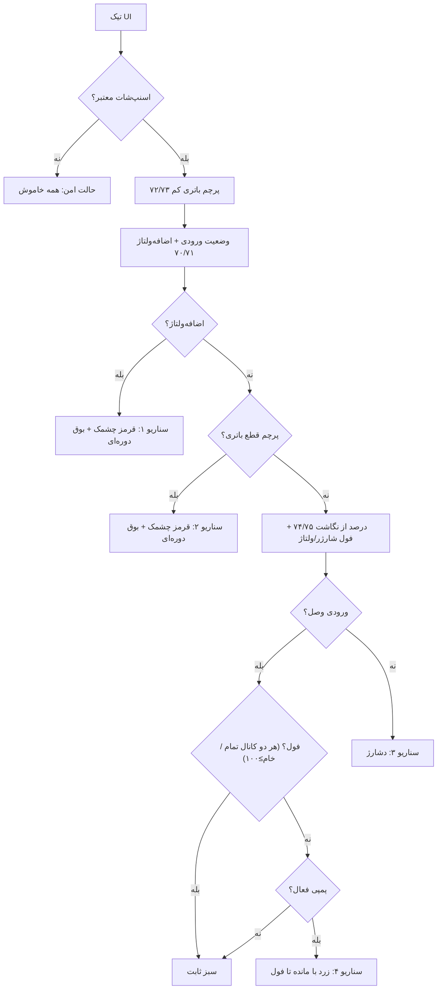
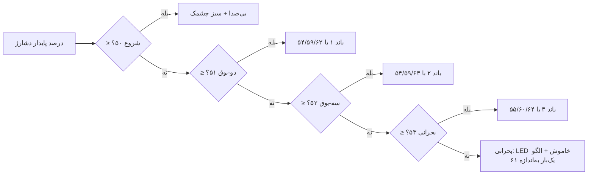

# ESP-Link Agent Spec — current contract

Status date: 2026-10-31. This is the single handoff document for the ESP panel and the
STM32 firmware pair. Where the code and this text disagree, the code wins and this file
must be corrected. Older version history was removed; it lives in `git log`.

## 0. What changed on 2026-10-11

- The battery-current table is built on the raw ADC counts axis and outputs mA.
  The Vin/Vbat power formula, the power LUT and the η parameters are removed.
- Gain and offset are used only above the last table anchor, and when no table is stored.
- Parameters 9 and 10 (η) are reserved. GET and SET for them are rejected.
- The bench capture has no voltage DMM columns (removed; see §4). Voltage calibration is separate from the table.
- Removed from this document: version history, the CAL_REFERENCE command (already not handled),
  the power-LUT conversion formulas and the bench-test narratives.

## 1. Parameter and NVM contract (current)

Authoritative endpoint contract for the current firmware/panel pair:

- `ESPLINK_PARAM_COUNT = ESP_PARAM_COUNT = 171`; ordinary wire ids are `0..170`.
- `PARAMS_BULK` is chunked at the 512-byte payload ceiling: at most 102
  `[id:u8][value:u32 LE]` items per frame. The receiver merges chunks by id.
- NVM format is version `12`, with capacity `172` entries. Persisted settings are
  ids `0..14` (ids `9` and `10` are reserved and rejected), `20..170` except derived `70`, retired `72/73` and transient session mute `76`,
  plus runtime slots `200..203`. The scenario-7 fault latch itself is RAM-only
  and is not an NVM setting.
- Scenario 7 is the technical board/power-stage fault face, and ids `143..146` configure Wi-Fi battery power saving:

| ID | Name | Type | Unit | Default | Range | Meaning |
|---:|---|---|---|---:|---|---|
| 137 | `TECH_BEEP_PERIOD_MS` | u32 | ms | 3000 | 0 or 1000..600000 | Scenario-7 beep pattern period; 0 disables sound |
| 138 | `TECH_BEEP_LEN_MS` | u32 | ms | 200 | 0..600000 | Length of each beep |
| 139 | `TECH_BEEP_COUNT` | u32 | n | 3 | 0..10 | Beeps per pattern |
| 140 | `TECH_BEEP_GAP_MS` | u32 | ms | 100 | 0..5000 | Gap between beeps |
| 141 | `TECH_LED_PERIOD_MS` | u32 | ms | 1000 | 100..10000 | Shared period for all three LEDs |
| 142 | `TECH_LED_DUTY_PCT` | u32 | % | 50 | 0..100 | Shared ON share for all three LEDs |
| 143 | `WIFI_IDLE_LOW_POWER_MS` | u32 | ms | 1800000 | 0..86400000 | Initial low-TX-power ON window on battery |
| 144 | `WIFI_CYCLE_ON_MS` | u32 | ms | 60000 | 5000..3600000 | ON window per cycle after initial window |
| 145 | `WIFI_CYCLE_OFF_MS` | u32 | ms | 120000 | 0..3600000 | OFF window per cycle after initial window |
| 146 | `WIFI_BAT_CUTOFF_PCT` | u32 | % | 20 | 0..100 | Battery % cutoff below which ESP stays completely OFF on battery |

Scenario-7 detection is not performed by the ESP. The STM32 detects either
`relay open + applied PWM 0 + recorded JIT`, or `applied PWM > 200 permille +
measured channel current 0 mA + channel battery >= 6000 mV (not BAT_LOST)`. The battery
condition keeps an unplugged battery from latching the lockout during the 1 s absent debounce. After detection the Charger keeps both PWM paths
stopped and the relay open until reset/power-cycle; only the three-LED face and
its six settings are exposed to the panel. This is the single current contract.

Ids `147..157` configure scenario 8 (weak-battery verdict), `158..164` are the
per-scenario alarm on/off ticks (the «فعال» tick of scenario cards 1..7), `165`
sets the rest-voltage floor that makes a re-cut count as weakness, and
`166..168` configure the charging thermal rest, and `169/170` are the shared input Schmitt return margins:

| ID | Name | Type | Unit | Default | Range | Meaning |
|---:|---|---|---|---:|---|---|
| 147 | `WEAK_ENABLE` | u8 | 0/1 | 1 | 0..1 | Scenario-8 verdict on |
| 148 | `WEAK_REST_MS` | u32 | ms | 600000 | 60000..3600000 | Continuous healthy rest until the verdict clears and one retry is allowed |
| 149 | `WEAK_CYCLE_GUARD_MS` | u32 | ms | 60000 | 1000..600000 | A repeat cut inside this window after a mains-free reconnect = weak pack |
| 150 | `WEAK_HEALTHY_HOLD_MS` | u32 | ms | 10000 | 1000..300000 | Unbroken healthy voltage needed before a mains-free reconnect |
| 151 | `WEAK_LED_PERIOD_MS` | u32 | ms | 500 | 0 or 100..10000 | Scenario-8 red blink period; 0 = solid red |
| 152 | `WEAK_LED_DUTY_PCT` | u8 | % | 50 | 5..95 | Scenario-8 red ON share |
| 153 | `WEAK_BEEP_PERIOD_MS` | u32 | ms | 3000 | 0 or 1000..600000 | Scenario-8 beep pattern period; 0 = silent |
| 154 | `WEAK_BEEP_LEN_MS` | u32 | ms | 200 | 20..2000 | Length of each beep |
| 155 | `WEAK_BEEP_COUNT` | u8 | count | 3 | 0..10 | Beeps per pattern |
| 156 | `WEAK_BEEP_GAP_MS` | u32 | ms | 100 | 0..5000 | Gap between beeps |
| 157 | `WEAK_BLOCK_OUTPUT` | u8 | 0/1 | 1 | 0..1 | Keep the weak pack off the output until the verdict clears |
| 158..164 | `SCN1_ALARM`..`SCN7_ALARM` | u8 | 0/1 | 1 | 0..1 | Per-scenario LED/beep tick (silences that scenario face; detection unchanged) |
| 165 | `WEAK_REST_FLOOR_MV` | u32 | mV | 25000 | 21200..29000 | Rest voltage that makes a re-cut count as weakness; below it the pack is discharged and never attempted |
| 166 | `CHG_THERMAL_TRIGGER_MA` | u32 | mA | 600 | 0..3000 | Thermal-rest current threshold; 0 = auto (bulkMax - 50) |
| 167 | `CHG_THERMAL_CONTINUOUS_MS` | u32 | ms | 3600000 | 0..21600000 | Continuous charge at/above the threshold that triggers the rest; 0 = rest off |
| 168 | `CHG_THERMAL_REST_MS` | u32 | ms | 600000 | 0..3600000 | Thermal rest length; 0 = rest off |
| 169 | `FAULT_INPUT_HYST_LOW_MV` | u32 | mV | 500 | 0..3000 and <= (q34-q33)/4 | Shared lower return margin |
| 170 | `FAULT_INPUT_HYST_HIGH_MV` | u32 | mV | 500 | 0..3000 and <= (q34-q33)/4 | Shared upper return margin |

The shared input permission is owned by Fault: outside `[q33,q34]` it releases
immediately; it re-arms only inside `[q33+q169, q34-q170]`. Charger, UI and
McuPowerPath consume that one permission. The OV alarm threshold is derived from
`q34`; id `70` is a read-only mirror and is not persisted. Only `q71` (OV clear
hysteresis) remains separately adjustable.


## 2. Battery-current chain (current)

```
raw ADC counts (12-bit, per channel)
  -> median (param 7) then moving average (param 8), on counts
  -> counts <= last anchor : table (counts -> battery mA), linear, ONE final rounding (UP to 0.1 mA)
                             below first anchor: hold Y[0]
  -> counts >  last anchor : Y_last + (BSP(c) - BSP(c_last)), one rounding
  -> no table stored       : BSP(c)
BSP(c)  = (c - offset) x 24200 / 27573 x gain / 1000        (gain, offset: params 0..3)
```

- Rounding rule: the table never rounds in the middle of a calculation; the final value is
  rounded once, UP to the next 0.1 mA (ceiling; the only integer rounding is the count axis, see below), so a reading is never below the
  table/chain value.
- Gain and offset never change the table itself. They only add the part above the last anchor
  and the no-table fallback.
- Table axis: counts, strictly increasing, 0..4095. Table values: mA, non-decreasing.
  Points: 2..24 (`CAL_LUT_POINTS_MAX = 24`). The 0% anchor is mandatory; its value is the measured
  current at that count (discharge clamped to 0).
- The table is stored in STM32 flash (CalLut module, one record per channel) and is pushed to the
  boards from the panel (`calapply` / `lsend`).
- Built by the panel from captured samples (`calbuild`):
  - raw mean counts are rounded to whole counts (the board axis is integer counts);
  - equal counts keep the MAXIMUM measured current (never below the DMM) and the count is reported;
  - negative (discharge) mA is clamped to 0 and reported, it never blocks the build;
  - a missing DMM value blocks the build and names the row;
  - no point is inserted automatically and no point is dropped silently.
- Push and commit (messages 0x04..0x08): `LUT_BEGIN`, `LUT_CHUNK` (points), `LUT_COMMIT` (ACK),
  `LUT_RESET` only after a successful COMMIT, `LUT_READ` for read-back. The payload layout is
  defined in `Firmware/Modules/EspLink/esp_link.c` (LUT handlers).
- Measured table: `Calibration Data/current_table_4a9da54.csv`, built from the DMM export
  `Calibration Data/bench_samples_4a9da54.json` (BAT2, duty 0-17 %). It is the table in use on the bench
  boards. Y is the highest DMM reading at each count, rounded UP to 0.1 mA. The chain
  formula `counts x 24200/27573` (no gain) was NOT the real relation: above about 11 % duty it read
  below the measured current (about 108 mA low at 17 %). BSP(c) above is the fallback formula only.

## 3. Voltage calibration (separate from the table)

- The panel does not calibrate voltages from DMM readings. The voltage inputs were removed from the calibration page, and no panel code computes voltage offsets any more.
- Voltage offsets (parameters 4, 5, 6: 24 V input, 24 V pack, 12 V node) keep their stored board values and are set by hand through the parameters.
- Vhigh = V24 − V12 is computed on the board, so parameters 5 and 6 affect it.
- Divider values (`Firmware/Bsp/Src/bsp_measurement.c`): 24 V top 68000 Ω, 24 V battery top 68000 Ω,
  12 V top 34398 Ω, bottom 6800 Ω on each.

## 4. Bench capture file (current)

- The column layout is defined by `ESP_BENCHLOG_HEADER` in `ESP_Calibration/plink_config.h`.
  That header is the source of truth; this file does not repeat it.
- Current-channel columns: `raw1/raw2` (counts), `shunt1_uv/shunt2_uv` (mA ≈ µV ÷ 10 with the
  10 mΩ shunt), `unf/filt/iest` (mA after the chain; `iest` equals the filtered current).
- The `[dmm]` group holds `dmm_i_in_ma`, `dmm_i_bat1_ma`, `dmm_i_bat2_ma`, `note` (the DMM voltage
  columns were removed; no code wrote them).

## 5. Wiring / physical

| STM32 pin | Label | Connect to ESP | Notes |
|---|---|---|---|
| PA9 | `USART1_TX` | ESP **RX** | 3.3 V logic |
| PA10 | `USART1_RX` | ESP **TX** | 3.3 V logic |
| PA8 | `MCU_ESP_CHPD` | ESP enable (CH_PD/EN per schematic) | Driven by the STM32, goes HIGH when the link task starts. **Do not drive from the ESP side.** |
| — | GND | GND | Common ground required |
| — | 3V3 | ESP supply | Per board schematic |

UART settings: **921600 baud, 8 data bits, no parity, 1 stop bit** (the
STM32 retunes its 115200 Cube default to 921600 at link init - user order
2026-09-23). 921600 runs reliably on both ESP8266 and ESP32 UARTs.

High-speed / zero-CPU transport on the STM32 side (user order
2026-09-23): reception is a 256-byte **circular DMA** ring (zero CPU per
byte, no reception interrupt at all) and transmission is **DMA from a
256-byte software ring** (non-blocking, whole-frame writes; a couple of
lightweight completion interrupts per frame, together ~20-40 IRQ/s at
the 100 ms telemetry cadence). A full 96-byte frame is ~1 ms of wire
time. The ESP side needs nothing special - it just sees a normal 921600
UART.

ESP -> STM burst budget: the STM drains its RX ring once per 100 ms
comm tick, so keep each burst under ~250 bytes (a handful of frames);
anything more can overflow the ring. Normal panel traffic is far below
this.

Timing: the STM32 sends one telemetry frame every **100 ms**
(`APP_CONFIG.comm_period_ms`). Replies to commands are queued
immediately and drain within ~1 ms.


## 6. Frame format (both directions)

```text
[0xAA][0x55][ver:u8][type:u8][len_lo:u8][len_hi:u8][payload: len bytes][crc_lo:u8][crc_hi:u8]
```

**Frame v2 (2026-09-29).** Two changes, both because this link carries the
calibration campaign and a silently wrong number there is worse than no number:

- `crc` = **CRC-16/CCITT-FALSE** (poly 0x1021, init 0xFFFF, no reflection, no
  final xor), little-endian, computed over `ver`, `type`, both length bytes and
  the payload — everything after the SOF pair.
  It replaces the old XOR-8. Measured, not argued: XOR-8 is blind to ANY even
  number of bit flips in the same bit position, which is exactly the pattern a
  switching converter couples onto a UART. Over 200000 two-bit same-position
  corruptions of 64-byte frames, **XOR-8 missed 100 %** and **CRC-16 missed 0 %**.
  Verified against the standard check vector: `"123456789"` → `0x29B1`.
- `ver` = **2**. Before this there was no version field, so flashing one board
  and not the other produced no error of any kind: the receiver dropped every
  frame whose length it did not expect and the panel went blank, which is
  indistinguishable from an unplugged cable. Both receivers now count version
  mismatches and CRC rejections, `/t` reports them as `vm` and `ce`, and the
  panel says plainly that the two boards were flashed out of step.
- All multi-byte payload fields are **little-endian**.
- Max payload length = **512 bytes** (v1.16; was 192 in v1.15 -
  PARAMS_BULK grew with the UI cadence parameters; an 83-param bulk is
  1 + 83 x 5 = 416 payload bytes, which no longer fits one length
  byte, so `len` is u16 little-endian since v1.16). Longer `len` =
  invalid frame. The ESP parser must accept up to 512 regardless of
  STM firmware version. Both boards MUST flash together (a v1.15
  board reads len_hi as payload and drops every v1.16 frame).
- On CRC error, unknown version or unknown type: the frame is dropped and the
  parser resynchronizes on the next `AA 55`. Both sides do this, and both count
  the rejection so a noisy harness is measurable instead of merely feeling
  unreliable.


## 7. Message types

| Type | Direction | Name | Payload |
|---|---|---|---|
| 0x01 | ESP→STM | SET_PARAM | `[id:u8][value:u32 LE]` (5 bytes) |
| 0x02 | ESP→STM | GET_PARAMS | empty (len = 0) |
| 0x03 | — | *(reserved, not handled)* | Was a v1.3 one-shot calibration command. The panel stopped sending it in v1.7 and the STM32 handler was carried dead for six versions - 172 source lines - until it overflowed the 62 KB flash budget by 92 bytes and was removed. The id stays RESERVED: reusing it would make an older panel's frames silently misinterpreted instead of harmlessly ignored. Calibrate by reading the raw ADC counts in the telemetry and writing coefficients back as ordinary SET_PARAM. Old targets 0/1 = GAIN ch1/2, 2/3 = ETA ch1/2 (v1.3, section 5.4) |
| 0x10 | STM→ESP | TLM_LIVE | **128 bytes**, layout in section 15 (historical sizes: 84, then 104, then 116) |
| 0x40 | ESP→STM | HELLO (v1.111) | `[wireVer:u8][espFw:u8][role:u8][flags:u8][uptimeSec:u32 LE]` (8 bytes). Sent every 2 s by BOTH panels. `role` 1 = user panel, 2 = calibration panel; `flags` bit0 = telemetry already seen, bit1 = a browser is polling. A HELLO with the wrong wire version or fewer than 8 bytes is refused, so a corrupted frame can never fake a link |
| 0x41 | STM→ESP | HELLO_ACK (v1.111) | 24 bytes: `[wireVer:u8][boardFw:u8][moduleFlags:u8][reserved:u8][boardUptime:u32][framesAccepted:u32][crcErrors:u16][versionErrors:u16][paramCount:u16][commPeriodMs:u16][echoedEspUptime:u32]`. `framesAccepted` is the board's OWN count of CRC-good frames it heard from the ESP - a dead ESP→STM direction shows 0 while telemetry still pours out. `moduleFlags` bit0 NVM loaded, bit1 charger, bit2 imbalance, bit3 diag. The board drops the "link" verdict after 6 s of silence and counts one loss; the next HELLO lifts it again with no reboot. Bit 0x40 of the TLM_LIVE flag byte carries the same verdict, so "frames arrive" and "the pair shook hands" are two separate indicators. A HELLO has NO other side effect: it must never be treated as "a user is connected" or it would reset the battery idle timer every 2 s and cancel the whole Wi-Fi power-saving schedule |
| 0x11 | STM→ESP | PARAM_REPORT | `[id:u8][value:u32 LE]` — the **applied** value (sent after every accepted SET_PARAM) |
| 0x12 | STM→ESP | PARAMS_BULK | `[count:u8]` then `count` × `[id:u8][value:u32 LE]` (answer to GET_PARAMS). **Since v1.28 the reply is CHUNKED into one or more frames:** 108 params would need 1 + 108×5 = 541 B against the 512 B ceiling, so each frame carries at most `(512−1)/5 = 102` items and the receiver merges whatever ids arrive, in any grouping (`func__Esp_StoreParamItem` is id-keyed, not index-keyed, so no ESP change was needed). 108 params = 2 frames (102 + 6). An empty trailing frame is never sent: it would read as "zero parameters known" |

Audit 2026-09-27: the 77-param growth had silently outgrown the STM32 256 B
TX ring, so every PARAMS_BULK reply was refused and a fresh panel never
learned the live values (it showed ESP-side defaults until each value was
touched). The ring is now 1024 B and the bulk payload is static - GET_PARAMS
is answered with the board truth again, and the manual-mode 1 s keepalive
bulk no longer burns ~900 B of the 1 KiB comm stack. v1.17 grows the
bulk to 83 params / 416 B, v1.23 to 98 params / 491 B and v1.24 back to
93 params / 466 B - still inside the
1024 B ring and the 512 frame ceiling (491 + 5 header + 1 xor = 497 B).
v1.28 is the first release that does **not** fit: the user-ordered limits
block takes the count to 108, so a single reply would need 541 B. Raising
`ESPLINK_FRAME_MAX_PAYLOAD` was rejected - that buffer is charged twice,
once on each side, and both sides are 20 KB parts. The reply is chunked
instead, at a bound DERIVED from the ceiling, so the two can never disagree.

Verified example frames (hex):

```text
SET_PARAM CUR1_GAIN_PERMILLE = 1200:
AA 55 01 05 00 02 B0 04 00 00 B2
                      └id=2  └value=1200 LE   checksum=B2

SET_PARAM CHG1_ENABLE = 0 (cut charger 1):
AA 55 01 05 00 0C 00 00 00 00 08

GET_PARAMS:
AA 55 02 00 00 02

PARAM_REPORT reply for id=2, applied=1200:
AA 55 11 05 00 02 B0 04 00 00 A2
```


## 8. Charge profile tab

A THIRD panel tab "تنظیمات" (v1.14b, was "تنظیمات شارژ") exposes the
automatic-charge profile AND (since v1.14b, user order 2026-09-26) the
current-filter windows (params 7 median / 8 average) under their own
"فیلتر جریان" section - the controls moved out of the panel tab, which
keeps only the live filter status line and the chart-sample count:
params 20..26 (shared by BOTH channels - one profile for both batteries).
Each field carries a Persian description in the tab; the applied value
reported back by the STM32 is shown next to the field, so a clamped write
is visible immediately. A "بازگردانی پیش‌فرض کارخانه" button restores all
seven defaults. v1.14 adds a live SVG STAGE GRAPH at the top of the tab: voltage
threshold bands (hard 15 V cutoff, absorb-over, absorb, absorb-enter,
float, reentry) plus a dashed PREVIEW of any typed-but-not-yet-applied
value. v1.14b: the graph uses the dark panel palette and every zone,
threshold and stage carries its English name beside the Persian one
(Bulk / Absorb / Float / Reentry / Over / Cutoff). v1.14c (user order
2026-09-26, "show each battery's position and state; the white Bulk curve
is confusing - are the zones not enough?"): the V(t) curve and the
reentry cycle arrow are REMOVED - the zones alone tell the story - and
each battery instead gets a live POSITION DOT on its own voltage column
(ch2 -> battery-low t[17]/state t[13]/current t[10], ch1 ->
battery-high t[18]/state t[6]/current t[3]) with a colored state chip
under the chart (voltage, current, bilingual state: خاموش/Off,
بالک/Bulk, ابزورب/Absorb, شناور/Float, faults red). v1.14d (user order
2026-09-26, "stretch the graph downward, the zone borders are cramped;
zones must follow the profile numbers and never overlap"): the chart is
taller (H 330 -> 560) with a collision-free label pass; zones are drawn
from the APPLIED board values (so they track every profile write within
a poll and can never invert or overlap - the firmware clamps the set),
while typed-but-not-applied values show as dashed preview lines only;
a panel-side guard (qchk) mirrors Charger_ClampProfile and raises a red
warning above the chart, paints the offending field red, and asks for
confirmation before sending any combo the board would clamp. v1.14e
(user order 2026-09-26, "at least 50% taller; what is the zone between
float and absorb?"): chart height 560 -> 840 (+50%); the band between
absorb-enter and float - where a non-full battery climbs at constant
current - is now an explicit Bulk zone with a light diagonal hatch and
a bilingual label, instead of the old nameless grey filler.

- Boot defaults equal the old compile-time setpoints (14400 / 14300 /
  14600 / 13500 / 12800 / 650 / 50) - a reflash changes no behavior.
- v1.14 (user order 2026-09-25, "must survive power loss"): every applied
  value is persisted to STM32 flash ~1.5 s after the last change (section
  5.8) - power cycles keep the profile; the factory button re-sends AND
  re-persists the defaults.
- Every write re-clamps the WHOLE set (Charger_ClampProfile): enter in
  [absorb−500, absorb−50], over in [absorb+100, min(absorb+400, 14750)],
  float in [9000, absorb−300], reentry in [8000, float−300], imax in
  [100, 900], taper in [10, min(300, imax)]; derived: regulation band
  bottom = imax−20, active current limit = imax+25.
- v1.15 (section 10): the hard current fault, the OV cutoff and the
  battery-validity floor ARE reachable from the alarms tab (ids 35..37)
  but DOWN-ONLY - never above 950 mA / 15000 mV. Still compile-time and
  unreachable: the JIT trip.
- Manual test mode (section 19) ignores the profile - manual duty is the user's
  own responsibility, only the hardware floor applies.


## 9. Parameter persistence in STM32 flash

User order: "I want to send the constants from the panel to the board and,
once sent, they must stay there and survive power loss." Scope: EVERY
settable parameter EXCEPT the transient test modes - that is ids 0..14
(offsets, gains, filters, charger enables, duty ceilings), 20..26
(charge profile), 27..37 (alarms, since v1.15), 38..75 (UI cadence,
since v1.16) and every later settable block through 170 (PID/limits,
imbalance, dead/weak battery, scenario ticks, Wi-Fi policy and the
charging thermal rest). The fixed-duty ids
15..18, manual test id 19 and the panel-session mute 76 (since v1.16b)
are NEVER persisted: after any reboot the charger is guaranteed to be in
its automatic mode and the buzzer unmuted.

- v1.66 (user order 2026-10-05): a SECOND, independent block of two 1 KiB
  pages (0x0800F000 / 0x0800F400) holds the bench calibration LUT pushed
  from the panel (module `Firmware/Modules/CalLut`, messages 0x04..0x07 and
  the 0x13 acknowledgement). It shares nothing with the parameter records
  but the flash driver, so a table transfer can never endanger the saved
  settings; application FLASH is 60K from that release on. A valid record
  overrides the compiled tables in calibration.h, which remain the fallback
  and remain pasteable by hand - both routes stay supported.
- Layout (v1.80): the parameter NVM is the 4 KiB region 0x0800E000..0x0800EFFF
  (bank A over the first two 1 KiB pages, bank B over the next two); the
  calibration LUT block of v1.66 keeps its two pages at 0x0800F000/0x0800F400;
  the old top pages 0x0800F800/0x0800FC00 stay reserved-unused - they are NOT
  handed back to the application, so a board upgraded from the field cannot see
  a stale record change meaning. The linker script shrinks application FLASH
  64K -> 56K today (60K before v1.80, 62K before v1.66) and
  adds the NVM regions, so an oversized image fails AT BUILD, not by
  overwriting records. Driver: `Firmware/Bsp/Src/bsp_flash.c` (direct
  RM0008 FPEC register sequences - no HAL flash sources needed).
- Record (esp_link_nvm.c): magic "CHO1" + version + wrap-around u16
  sequence + up to 172 {id, value} slots + CRC32 over everything before it.
  A record containing any non-persisted id is rejected WHOLE. v1.15 bumps
  the version 1 -> 2, v1.16 bumps it 2 -> 3, v1.16b bumps it 3 -> 4
  (id 76 turns transient, so v3 records may carry it): upgrading LOSES
  a set saved by the previous version - both boards reflash together
  and the panel re-sends the set.
- Power-cut safety (ping-pong): each save erases the two 1 KiB pages of the
  bank that does NOT hold the newest record, then programs the new record there and verifies
  by read-back. A cut during erase or program can never destroy the
  previous good record; boot picks the CRC-valid record with the newest
  sequence (int16 difference, wrap-safe).
- Charger suspension (audit 2026-09-27, user order: "idle the charger,
  save, restart it"): ~1.5 s after the last edit the comm task sets the
  suspension flag, waits (<= 200 ms) until both PWM compares read 0, and
  only then erases/programs - so NO switching happens inside the
  ~30..50 ms CPU-wide flash stall (F1 single bank, no read-while-write:
  SysTick time jumps, EXTI/UART ISRs go latent, in-flight UART bytes
  overrun into CRC retries). Charge state, soak and settle are untouched
  and resume seamlessly; the one stretched comm pass delays a single
  TLM_LIVE frame by ~0.2 s.
- Boot: `func__App_Init` (pre-scheduler, under MODULE_ESP) replays the
  record through the SAME `func__EspLink_ApplyParam` clamped setters the
  panel path uses - a stale or hostile record can only land inside the
  compiled safety windows; module Init functions reset channel state,
  never the settable statics, so the loaded values survive them. Both
  records invalid (fresh board / corruption) = compiled defaults, nothing
  applied.
- Save path: a successful SET_PARAM of a persisted id arms a dirty flag;
  `func__EspLink_Run` calls `func__EspLink_NvmTick` every comm period and
  saves ~1.5 s (15 runs) after the LAST change - one two-page bank erase +
  program per burst, not per keystroke. A failed verify retries up to 3 times,
  then the save PARKS (no erase loop on a worn page): the value stays dirty in RAM
  and nothing is discarded. The next persisted change, or the reset flush before
  a LUT reset, tries again.
- Cost note: an F1 page erase stalls ALL flash instruction fetches for
  typ. 20..40 ms - the measurement/charger loops hiccup once per save
  (rare event); one UART frame may be lost around a save (the parser
  resyncs, the panel polls).
- Wire protocol: UNCHANGED. The panel reads the persisted values back
  through the existing GET_PARAMS / PARAMS_BULK path after a reboot.
- Host verification: the exact flash-state code is compiled against a
  RAM-emulated flash with fault injection (cut during erase, cut during
  program, bit-flip corruption, hostile record, out-of-window value,
  sequence wrap, transient-id rejection) - see host_test_charger.py
  v1.14 (test_charger_persistence_v114).


## 10. Alarms tab

User order: "an alarms tab - the number behind every alarm must be
editable from the ESP panel and stick on the board MCU." An "آلارم‌ها"
SUB-TAB inside the settings tab (v1.15b - the user moved it in from a
fourth top-level tab) exposes params 27..37 in three grouped cards,
each field with a Persian description and the APPLIED board value
beside it, plus a "بازگردانی پیش‌فرض کارخانهٔ آلارم‌ها" button:

- Battery supervision (27..32): wire-cut threshold + debounce (27/28),
  absent/back thresholds + debounces (29..32). Boot defaults are the old
  FAULT_* macros (14800 / 150 / 6000 / 7000 / 1000 / 1000).
- Input window (33/34): the "input present" range (default 21..28 V).
- Charger safety ceilings (35..37): hard current fault (950), OV cutoff
  (15000), validity floor (2000) - DOWN-ONLY from the panel, never above
  the compile maxima.

A live status card (v1.16d: at the end of the main panel tab, not in settings) shows five grouped boxes (input, battery low/high,
one filtered-current box per channel: big live value + threshold line +
status pill) plus a fault box with a per-bit EXPLANATION of every
latched fault bit and what to do; four threshold bars (input window,
batteries vs absent/back/cut, one current bar per channel vs hard
fault) sit below (v1.16c - no more max-of-both merge). v1.15b builds the skeleton ONCE and
updates text/color per poll (no rebuild flicker). A panel-side guard
(achk) mirrors Fault_ClampAlarms + Charger_ClampAlarms: red warning +
red field + confirm-before-send on invalid combos. Because 38 params no
longer fit one u32, /t carries a second pending mask `q2` for ids 32..37
alongside `q` for 0..31. A single backup card in its own settings
sub-tab (v1.16d - ONE backup for the whole settings, not per tab;
v1.16c had it at settings-tab level) exports/imports ALL 77 persisted
values (0..14, 20..75, 77..97) as a JSON file (`changeover-settings.json`).

Firmware clamps (every write re-clamps the whole cascade - profile ->
charger alarms -> fault alarms, so a profile write can re-float a
lowered OV or disconnect threshold):

- 27 in [max(14000, over+50), min(15000, OV−100)] (floor wins a transient
  empty range - no false trips; the OV cutoff still protects);
- 28 in 50..1000; 29 in 3000..8000 and <= back−500; 30 in 4000..9000 and
  >= absent+500; 31/32 in 100..5000; 33 in 18000..24000 and <= max−1000;
  34 in 24000..30000 and >= min+1000; 35 in [imax+50, 950]; 36 in
  [max(14000, over+150), 15000]; 37 in 0..8000.
- Boot defaults equal the old compile-time numbers - a reflash with an
  unreadable (v1) NVM record changes no behavior; applied values persist
  ~1.5 s after the last change (section 9).


## 11. UI LED and buzzer mirror

User order: "draw the LEDs for every fault/alarm so they really blink;
show the buzzer with an icon that gets a cross on mute; every alarm
number editable - ranges, beep times, beep counts and the like." Params
38..82 (table above) are the 45 UI cadence numbers in one live struct
(`UI_ALARM_T__G__Alarm`), set-clamped on every write and persisted like
the rest (section 9). Boot defaults equal the old UI_* macros - a
reflash with an unreadable (v2) NVM record changes no behavior or sound.

- Fault scenarios (38..49): input-overvoltage (red blink + beep,
  priority 1) and battery-lost (red blink + beep while the fault bit is
  latched, priority 2); green stays solid in both because the input is
  present.
- BatteryRun bands (50..65): four pack-percent bands (always start >=
  double >= triple >= crit); band beeps while the input is absent; below
  crit every LED turns off and the critical pattern (56/57/58/65) plays
  once for the latch length (61 - defaults: one 10 s beep), then silence
  until the battery recovers. Every scenario beep carries its own count
  + gap + period/duration (v1.16e): OV 40/41/42/43, BatLost 46/47/48/49,
  band1 54/59/62, band2 54/59/63, band3 55/60/64, crit 56/57/58/61, gap 65
  shared by all run bands; the board clamps each window to fit (crit
  pulls its COUNT down) and the panel warns before sending.
- Beep audibility floor (audit 2026-09-27, user decision: keep behavior +
  document): the UI task samples every pattern at a fixed 10 ms cadence,
  so a beep duration of 1..9 ms can fall between two samples and sound
  short or never sound at all (0 = deterministic off; >= 10 ms always
  renders). All compiled defaults are >= 100 ms; only a hand-typed 1..9 ms
  duration is affected. The panel shows durations as sent - prefer
  >= 10 ms for an audible beep.
- Normal blink (66..69): green (BatteryRun: OFF time = remaining x
  period/100) and yellow (charging: ON time = remaining x period/100,
  only while a channel is really charging; full = steady green).
  v1.20 (user order 2026-09-28: "even at 1% the yellow must blink once -
  say it never goes below 2%; fully dark only when the charger is cut"):
  the remaining-to-full is floored at 2% (compiled constant
  UI_CHARGING_YELLOW_MIN_REMAINING_PERCENT, no new wire id) and a 100%
  reading mid-charge no longer darks the yellow - while any channel is
  pumping the Charging face keeps blinking (the id 69 ON floor keeps the
  blip visible); the full face yields to it until the charger is cut
  (charge complete / no active channel).
- Thresholds (70..75): the runtime OV latch, the continuous low-battery
  flag (72/73), and the pack-voltage-to-percent map (74/75, strictly
  positive range).
- Mute (76): panel-session only (v1.16b - user order: "mute lives only
  while I work with the panel; after a board reset it must be back in
  its own scenario"): RAM-only, never flashed, excluded from the JSON
  backup; silences the scenario beeps only - LEDs keep blinking and
  the boot wiring-test beep still sounds.

The settings sub-tabs are (v1.16d): s1 scenarios - the mirror + ONE
selectable card per scenario (v1.16b - a picker row: overvoltage /
battery-lost / BatteryRun / normal charging / battery thresholds;
each card only its own numbers, e.g. scenario 1 carries its voltage
ceiling 70/71 together with its blink/beep timing 38..43) + its own
guard readout (aw2) + its own factory-defaults button (sdef, 38..82);
s2 supervision & safety - the 27..37 threshold cards + their guard
readout (aw) + their defaults button (adef, 27..37 only); s3 backup.
The guard (achk) covers the whole set (window fits, band order,
threshold order) and each sub-tab shows only its own warnings, and a
third pending mask `q3` in /t covers ids 64..82. ONE sticky mirror header stays pinned above everything: the 3
board LEDs blinking at the board's APPLIED period/duty (panel-side
phase), the buzzer icon (dim = silent, bright = beeping now, cross
overlay = muted), the active scenario name, a live readout of the
effective timing (period/duty/beep counts/thresholds, straight from the
applied board values), and the mute toggle (76 = hidden field). The
fault box adds one LED per fault bit (blinking while latched). The
bench CSV gains the [uicad] block (134 columns since v1.17).

Scenario flow (v1.16e - one scenario wins per tick, top priority first;
each scenario resets the foreign blink/beep states so patterns never mix):





Beep anatomy (every pattern = period + duty window + count + gap;
`w = dur*count + gap*(count-1)` must fit the window):

```
دوره (40 / 46 / 54 / 55 / 56)
|<————— پنجره = دوره × دیوتی٪ —————>|<—— سکوت tail ——>|
[ بوق ][گپ][ بوق ] … [ بوق ]
 مدت   گپ   مدت       مدت
```

OV / BatLost / band beeps derive the duty from their typed duration
(the board pulls the DURATION down to fit); the critical beep takes
its duty (57) directly and the board pulls its COUNT (58) down to fit
(v1.16e - an unfit crit window would otherwise go INVALID = dark AND
silent on a dying battery). Zero period / duty / count is always a
valid intentional silence.

Wire change (BREAKING - both boards reflash together): the frame length
is now u16 little-endian (`AA 55 type len_lo len_hi payload xor`,
6-byte header incl. the version byte, 512 ceiling, CRC-16 over everything after the SOF pair) because the
77-param bulk (1 + 77 x 5 = 386 bytes) no longer fits one length byte.
A v1.15 parser reads len_hi as the first payload byte and drops every
frame - mixed versions NEVER link.


## 12. Two-loop CC/CV charge PID

Two user orders built this section. 2026-09-28: *"slow the absorb duty rise
down, and instead of all that complexity write a three-stage PID — one gain
set at the start, one in the middle, one in the last region — and expose it
on the ESP panel."* 2026-09-29: *"you have to remove that previous logic, it
must be PID only for the charger now; and you calibrate it yourself from the
tables for the first time so I can optimise it later; also the 650 mA limit
and 14.8 V must be ACTIVE so the batteries are not damaged."* 2026-09-29
(second): *"if we do it with one PID over the whole path does it not work?
do we have errors? it does not matter if it is slow, because the battery
itself is slow; my goal is maximum accuracy by the simplest method."*

#### What was removed

The old regulator was a chain of fixed steps on fixed timers: in ABSORB,
+0.1 permille every 2000 ms below the target, −0.1 every 1000 ms above it,
−0.5 every 500 ms above the over-voltage ceiling; in BULK, ±0.5 permille on
a 20 mA-wide current band. v1.22 bypassed it behind an enable flag; **v1.23
deletes it** — 146 lines of regulator, plus `CHG_REGULATE_LOW_MA`, the two
up-step cadences, the absorb cadences and the fine-step constant. The enable
flag (v1.22 id 83) went with it, since there is no longer anything to select
between; the PID block therefore renumbered down one to 83..97 (and v1.24
reduced it again to **83..92**). That
renumbering is safe precisely because v1.22 was never flashed. A host test
now fails if any of those symbols reappear.

#### The loop

One positional PID per channel, updated every `CHG_PID_PERIOD_MS` (100 ms =
one current-filter window), running a textbook CC/CV **min-select**:

| Branch | Error | Gain row |
|---|---|---|
| Current (CC) | `bulk_imax − 10 mA − I` | the **current** row (ids 83..87) |
| Voltage (CV) | `setpoint − Vbat` | the **voltage** row (ids 88..92) |

Both branches are evaluated every pass and **the one asking for the smaller
duty wins**; the winner alone drives the shared integrator and its own slew
limits. Neither row is selected by the pack voltage — each row belongs to a
physical loop, permanently.

#### How TWO loops drive ONE duty (there is no second output)

A fair question when reading the parameter table: ten numbers, two rows —
so where does the second duty go? **There is no second duty.** There is one
output, one integrator, and two loops that take turns driving it.

Picture two people standing over a *single* knob. The rule is one line:
**whichever of them wants the knob lower gets to turn it**, and the other is
ignored entirely for that pass — not averaged, not summed. One says "don't
let the current pass 640 mA", the other says "don't let the voltage pass
14.4 V".

Real trace from `Firmware/Modules/Charger/Tester/pid_tuning_sim.py`, factory tune, nominal pack
(the two "wants" are P+D terms in milli-permille):

| Minute | V (mV) | I (mA) | Current loop wants | Voltage loop wants | Winner | Duty |
|---|---|---|---|---|---|---|
| 0.0 | 12200 | 6 | **+7608** | +110000 | current | 18 |
| 5.0 | 12327 | 553 | **+1044** | +103650 | current | 172 |
| 50.0 | 13198 | 637 | **+36** | +60100 | current | 191 |
| 113.35 | **14400** | 640 | +0 | **+0** | **voltage** ← handover | 200 |
| 115.0 | 14413 | 541 | +1188 | **−650** | voltage | 184 |
| 130.0 | 14402 | 54 | +7032 | **−100** | voltage | 58 |
| 240.0 | 14400 | 50 | +7080 | **+0** | voltage | 56 |

Early on the pack is flat, so the voltage loop has enormous headroom and
would happily add 110 permille; the current loop only wants 7.6. The
smaller number wins, so the current loop drives — that *is* CC. At minute
113 the pack reaches 14.4 V, the voltage loop's number goes **negative**
("pull down"), and it takes the knob — that *is* CV. Over a whole charge
the handover happens exactly **once**.

**Why the handover does not bump.** Look at the 113.35 row: the integrator
reads 199511 before and after, and the duty stays at 200. Zero jump. That
is precisely because the integrator is **shared**. If each loop owned a
private integral, the idle one would have drifted somewhere else and the
duty would jump the moment control changed hands.

```c
bool__useVoltage = ((termPv + termDv) <= (termPi + termDi));
if (useVoltage) { error = errorVoltage; gainI = voltageKi; ... }
else            { error = errorCurrent; gainI = currentKi; ... }
/* from here on ONE path: one rate, one pidIntegral, one demand, one duty */
```

Note the comparison is on **P+D**, not on a finished duty: neither loop ever
computes a duty of its own. Each only says "this is how far I want the knob
moved", and the winner applies that to the shared integrator. The technique
is standard and has a name — **min-select** (low-selector) control, the same
arrangement used in industrial CC/CV chargers and in gas-turbine fuel
control.

#### How simple can it get? (the v1.24 question, answered by measurement)

The user asked whether **one** PID over the whole path would do, noting that
slowness is acceptable *"because the battery itself is slow"*. The honest
answer needed numbers, not opinion, so every candidate was run through
`Firmware/Modules/Charger/Tester/pid_tuning_sim.py` — a faithful transcript of `func__Charger_PidStep`
that **reads its constants out of `charger.h` by regex** rather than copying
them, driven by a plant fitted to the real converter. Ten hours simulated,
ten scenarios each:

| Architecture | Numbers to tune | Peak V | Peak I | Duty reversals / 10 h | Verdict |
|---|---|---|---|---|---|
| One PID, shared row, min-select | 5 | 14413 | 644.8..668.5 | 1408..84660 | ✗ hunts |
| One PID on voltage only, backstop as the current limiter | 5 | 14404.5 | **706.9** | 8136..28808 | ✗ over-current |
| **Two rows (current + voltage)** | **10** | **14414.3** | **642.0** | **4** | ✓ **shipped** |
| Three rows (v1.23) | 15 | 14414.0 | 642.0 | 4 | = no better |

Two failures worth keeping in the record:

* **A shared row cannot work** because `e_v` is in millivolts and `e_i` is in
  milliamps. One Kp cannot be "permille per volt" and "permille per amp" at
  the same time, so the min-select compares unlike quantities and the duty
  hunts instead of crossing over cleanly.
* **Voltage-only + the 650 mA backstop fails on the user's own safety
  requirement.** A backstop is *reactive*: it can only respond **after** the
  limit is crossed, so the current limit-cycles and peaks at **706.9 mA**
  instead of sitting at 640. The only tune that stayed under the limit
  (Kp = 50 alone) locked the current at 351 mA and never finished the charge
  (230 min). **A limiter is not a regulator.**

So two rows is the floor: one PI per physical quantity being limited. The
third row was then measured to be pure cost — see below.

#### Why the third row was deleted

v1.23 split the voltage row at the setpoint (one set climbing, one holding).
Re-measured with a **seeded broadband PRNG** noise model instead of the
deterministic tone used originally, the split buys nothing, and the two-row
design tuned properly is strictly quieter:

| Design | Clean | ±7 mV | ±15 mV | ±30 mV |
|---|---|---|---|---|
| Three rows, Kp_v 150/300, N=16 (v1.23) | 4 | 1275 | 4576 | 11061 |
| Two rows, Kp_v 150, N=16 | 4 | 744 | 3448 | — |
| **Two rows, Kp_v 50, N=32 (v1.24)** | **4** | **62** | **104** | **270** |

(duty reversals per 10 h, mean of 4–5 seeds). Overshoot, hold error
(0.5 mV) and time-to-14.4 V (113 min) are **identical** across that table —
the only thing that changes is how hard the duty works. Five fewer numbers
to tune, ~12× less duty motion, same accuracy.

> **Audit note.** The original "50913 → 3" figures published in v1.23 came
> from a *deterministic sinusoidal* noise model, which turned out to be
> chaotic enough in its reversal count to reverse a design decision: it first
> argued the third row was needed for noise, and the seeded PRNG showed the
> opposite. The tables above supersede them. Any future noise claim must use
> a seeded PRNG averaged over ≥4 seeds.

**Why the slew limit is on the integral, not the output.** The PWM stage
takes whole permille, so every time the applied duty crosses an integer the
measured current jumps and the P term ripples. An output rate-limiter with a
fast down-rate and a slow up-rate **rectifies** that zero-mean ripple into a
steady downward ratchet: in simulation the loop stalled at 268 mA and never
reached the 640 mA band. Rate-limiting the integral and letting P+D ride on
top unclipped leaves the ripple zero-mean.

**Units** (integers only, no floats in firmware):

```text
P term  [milli-permille]   = Kp x error / CHG_PID_KP_DIV   (KP_DIV = 1)
I rate  [milli-permille/s] = Ki x error / CHG_PID_KI_DIV   (KI_DIV = 1000)
D term  [milli-permille]   = Kd x (error - prev) / CHG_PID_KD_DIV  (KD_DIV = 1)
```

so Kp reads as "permille of duty per volt (or per amp) of error" and
Ki = 1000 means "one permille per second per volt". Slew rates are
milli-permille per second: 1000 = 1 permille/s.

**Order of operations each update** (all int32, overflow proven by
`_Static_assert` in charger.c):

```text
1  hard backstops shrink the duty ceiling, from the RAW measurements
2  bumpless re-seed if the hardware duty drifted from the integral
3  cadence gate (one update per 100 ms), then advance the voltage prefilter
4  clamp both errors to +/-CHG_PID_ERROR_CLAMP (4000)
5  P and D per branch from ITS OWN row; D only for the branch that also won
   the previous pass
6  min-select on (P + D) -> the winner's error, Ki and slew pair
7  rate = Ki x error / 1000, clamped to [-down_rate, +up_rate]
8  integral += rate x dt (sub-unit remainder carried), clamped into
   [0, ceiling] = anti-windup
9  demand = clamp(integral + P + D, 0, ceiling)
10 output hysteresis (CHG_PID_OUTPUT_HYST_MILLI)
11 symmetric mis-tune cap (CHG_PID_MAX_STEP_PERMILLE)
12 absolute ceiling cap - LAST, so a backstop always reaches the hardware
```

#### The three numerical-hygiene constants

None of these are tunable; all three exist because an audit measured a
problem that the control law alone did not solve.

| Constant | Value | Problem it solves | Measured |
|---|---|---|---|
| `CHG_PID_OUTPUT_HYST_MILLI` | 700 | Whole-permille PWM makes the applied duty toggle between two neighbouring integers whenever the integral rests near a boundary | 15570 duty reversals per 10 h without it, **4** with it (legacy chain: 6456) |
| `CHG_PID_VOLT_FILTER_N` | 32 | Current is filtered upstream, pack voltage is not; ~7 mV of ADC step times Kp lands on the duty | reversals/10 h at ±7 mV / ±15 mV broadband noise: N=1 → 32307/69656, N=8 → 115/931, N=16 → 72/186, **N=32 → 62/104** |
| `CHG_PID_MAX_STEP_PERMILLE` | 8 | The integral is rate-limited but P is not, so panel-maximum gains jumped the duty across its range in one pass | **4475 mA** for 100 ms under abuse without it, **704 mA** with it |

The hysteresis is deliberately below the 1 permille re-seed tolerance so its
lag can never be mistaken for a foreign writer (`_Static_assert`). The
mis-tune cap is **symmetric** — the asymmetric limiter tried earlier is the
one that created the downward ratchet — and it is applied *before* the
absolute ceiling so it can never slow a backstop down.

#### The two hard backstops

```text
I > bulk_imax (live id 25, 650 mA)  ->  ceiling = applied - 100 x (I - limit)
V > CHG_PID_BACKSTOP_MV (14800)     ->  ceiling = applied - 500 x (V - limit)
```

They are a **shrinking ceiling proportional to the excess**, not a trip: 1 mA
over costs 0.1 permille and nothing visibly moves, 50 mA over costs 5
permille and the duty is pulled down hard. A fixed step would re-create the
hunting this rewrite removed; a latching trip would abort a healthy charge on
one noisy sample. They read the **raw** measurements, never the prefiltered
voltage, so protection is never delayed by a filter. The integral is clamped
to the same shrunk ceiling, so no windup survives.

They are **not on the panel, on purpose.** The user's stated reason for
wanting them is that they intend to re-tune the coefficients later; a
backstop that can be edited from the same screen as the gains protects
nothing. The current limit tracks the live profile value, so lowering the
charge current on the panel lowers the backstop with it.

These do **not** replace the existing protections. The 950 mA hard fault, the
15.0 V OV cutoff, the battery-valid floor, the JIT gating, the input-present
window, the 500 permille DCM ceiling and the whole BULK/ABSORB/FLOAT machine
all still run: those cut the charge and raise alarms, these merely keep the
regulator from taking the pack there.

#### Factory calibration

Every coefficient was swept on the plant model against the charge-profile
table (14.4 V absorb, 14.3 V enter, 14.6 V over, 650 mA bulk, 500 permille
ceiling) rather than hand-picked. What changed from the v1.22 hand-set
values, and why, is in the block comment above `CHG_PID_CURRENT_KP` in
charger.h and in the parameter table above.

**Normal charging, 10 simulated hours, calibrated defaults:**

| Scenario | Peak V | Peak I | Duty reversals | To 14.4 V | Absorb hold |
|---|---|---|---|---|---|
| nominal | 14414 mV | 642 mA | 4 | 113 min | 14399.3..14399.6 |
| flat 11.0 V start | 14414 | 642 | 4 | 176 min | 14398.5..14399.6 |
| 0.05 Ω short leads | 14426 | 642 | 6 | 117 min | 14400.2..14400.3 |
| 0.30 Ω long/worn | 14409 | 642 | 2 | 108 min | 14399.6..14399.9 |
| new pack (low acceptance) | 14415 | 642 | 3 | 113 min | 14400.2..14400.2 |
| worn pack (high acceptance) | 14410 | 642 | 6 | 116 min | 14400.4..14400.5 |
| small pack | 14429 | 640 | 8 | 47 min | 14399.6..14400.1 |
| big pack | 14408 | 643 | 31 | 224 min | 14400.5..14400.5 |
| ±15 mV sensor noise | 14429 | 642 | 12 | 113 min | 14384..14415 |
| ±40 mV sensor noise | 14454 | 642 | 7718 | 111 min | 14359..14439 |

The ±40 mV row is an honest worst case, not a target: that is 5..6 ADC steps
of noise. If the bench ever sees that much, raise `CHG_PID_VOLT_FILTER_N`
rather than detuning the gains.

**Abuse, 6 simulated hours, every gain pushed to the panel maximum:**

| Tune | Peak V | Peak I | Max duty |
|---|---|---|---|
| all fifteen gains = 20000 | 14410 mV | 685 mA | 207 |
| current loop maxed | 14411 | 681 | 195 |
| voltage loops maxed | 14411 | 642 | 200 |
| derivative cranked | 14434 | 704 | 207 |
| integral only, huge | 14413 | 671 | 202 |
| all gains zero | 12221 | 2 | 10 (the pack simply never charges) |

So **no combination the panel allows** takes the pack past 14.8 V or 950 mA.
That is the property the backstops plus the mis-tune cap were added to
guarantee, and it is what makes the user's "I will optimise it later" safe.


## 13. Charger limits, backstop gains and stage timers

User order, verbatim in spirit: *every gain, every limit and every parameter
must be changeable from the panel*, and *the operating table belongs inside
the chargers page itself*. The absorb current ceiling and the one-hour
absorb wall were called out by name.

Before this release the PID help text in the panel ended with the sentence
"the two hard backstops are always active and **are not settable from the
panel**". That sentence was accurate and it was the problem: fifteen numbers
that shape charging behaviour were compile-time `#define`s, so changing any
of them meant a rebuild and a re-flash.

| id | name | unit | min | max | default |
|---|---|---|---|---|---|
| 93 | `ABSORB_MAX_MS` | ms | 0 = no wall | 21 600 000 | 3 600 000 |
| 94 | `ABSORB_MAX_ARM_MA` | mA | 10 | 500 | 100 |
| 95 | `ABSORB_HOLD_MS` | ms | 0 | 7 200 000 | 600 000 |
| 96 | `TAPER_SUSTAIN_MS` | ms | 1 000 | 600 000 | 60 000 |
| 97 | `PID_MAX_STEP_PM` | ‰/step | 1 | 100 | 8 |
| 98 | `PID_OUT_HYST_MILLI` | m‰ | 0 | 999 (derived) | 700 |
| 99 | `PID_VOLT_FILTER_N` | — | 1 | 64 | 32 |
| 100 | `BACKSTOP_MV` | mV | 13 000 | 14 800 (down-only) | 14 800 |
| 101 | `BACKSTOP_GAIN_I` | ‰/A over | 0 = off | 2 000 | 100 |
| 102 | `BACKSTOP_GAIN_V` | ‰/V over | 0 = off | 2 000 | 500 |
| 103 | `PID_CUR_MARGIN_MA` | mA | 0 | 100 | 10 |
| 104 | `CONNECT_SETTLE_MS` | ms | 0 | 120 000 | 15 000 |
| 105 | `JIT_LOCKOUT_MS` | ms | 0 | 60 000 | 3 000 |
| 106 | `MANUAL_WATCHDOG_MS` | ms | 500 | 60 000 | 3 000 |
| 107 | `RAMP_DOWN_INT_MS` | ms | 50 | 5 000 | 500 |

**Deliberately NOT in this block.** `CHG_DUTY_MAX_PERMILLE` (500‰) is a
property of the board's DCM magnetics, not a preference - ids 13/14 already
lower it per channel. The 950 mA hard fault and the OV cutoff keep their
existing down-only ids 35/36: a safety trip that can be raised is not a
safety trip. `CHG_CURRENT_LIMIT_MA` was **deleted** rather than exposed - it
had zero readers and had been dead since the profile limit replaced it.

**Row 98's ceiling is derived, not chosen.** The first attempt used a round
5000 and the build failed: the output hysteresis must stay below the re-seed
tolerance or the loop can hysteresis its way past a re-seed. The ceiling is
now `CHG_LIMIT_MAX_PID_OUT_HYST_MILLI`, computed from that tolerance. The
general lesson, which cost a build: **when a constant becomes a parameter,
the asserts must constrain the whole settable window, not just the boot
default.**

**Implementation.** One X-macro `CHG_LIMIT_ROWS(X)` in `charger.c` emits the
bounds table, the live value array and three `_Static_assert`s per row (in
the id block, default above its floor, default below its ceiling). The
dispatch in `esp_link.c` is a range test, not a switch arm per id - this part
has overflowed the 62 KB flash budget before.

**Consequences, all of which are build-enforced:**

- `ESPLINK_PARAM_COUNT` 93 → 108, `ESP_PARAM_COUNT` likewise.
- PARAMS_BULK no longer fits one frame → chunked (section 4).
- Pending masks: ids 96..107 need a **fourth** word. The old code funnelled
  every id ≥ 64 into mask 3, so id 96 evaluated `1UL << 32` - undefined
  behaviour in C, hidden on the panel side by JavaScript's modulo-32 shift.
  `q4` had been emitted as a constant 0 since v1.24; it is real again.
- **NVM layout v8 → v9** (`ENTRY_MAX` 108, record 12 + 108×8 + 4 = 880 B in a
  1024 B page). A v8 record describes 93 slots, so replaying one would leave
  ids 93..107 holding erased flash. The version check rejects it.

> ⚠ **Upgrade note.** The first boot after flashing v1.28 is a
> factory-default boot: saved settings are discarded by the version check.
> Export your settings from the panel's backup card first, flash **STM32 and
> ESP together**, then import. Restoring a v8 export is safe - the import
> replays values id by id, and the ids did not move.


## 14. Where these are edited

The **chart is the editor; the operating table only reports.** Click any
underlined number on the stage chart (Settings → "شارژ و فیلتر"), type, Enter.
Escape cancels. The operating table on the chargers page shows the same values
and sets none of them.

Three renderers decide where each id appears, and the audit reads those three
lists to prove nothing lost its editor:

| list | axis | ids |
|---|---|---|
| `EVV` | horizontal voltage lines | 20, 21, 22, 23, 24, 36, 100 |
| `EVI` | vertical current lines | 25, 26, 35, 94 |
| `EVC` | chips under the plot | 93, 95, 96, 97, 98, 99, 101, 102, 103, 104, 105, 106, 107 |

`EVC` exists because a time and a gain have no honest position on a
voltage/current plane. Putting them on an axis they do not belong to would be
a prettier lie than leaving them off it.

Two consequences worth recording:

- `IMAX` (the current axis range) is now derived from the hard-fault threshold
  as well as the bulk ceiling. It used to be `bulk × 1.25`, which pinned the
  950 mA fault line to the right-hand edge — a current chart that clips a
  current limit at its border is a quiet lie, and the label still read
  "950mA" while sitting in the wrong place.
- The editor is a floating panel on `<body>`, not an `<input>` swapped into
  the label, because an SVG `<text>` cannot host one. One mechanism serves the
  axis labels and the chips, so they cannot disagree.

The 15 V line stays read-only: it is `CHG_MAX_VALID_BATTERY_MV`, the board's
measurement validity ceiling, not a setting. So does the duty ceiling shown in
the table — that is `max(id 13, id 14)`, a derived number with no parameter
behind it.

**The operating table moved into the chargers page.** It is rendered from the
board's *applied* parameters, never from numbers written into the markup.
That is not decoration: this same release found a stale help sentence, a
stale backup label (it still advertised a retired 83..97 range), and an OV
cutoff default that the documentation and the panel both got wrong - the
firmware boots 15000 − 150 = **14 850 mV** while the comment said 15 000 and
the panel's factory-restore button pushed 15 000, i.e. it *raised* a safety
ceiling. A table built from live values cannot drift that way.


## 15. TLM_LIVE payload layout (128 bytes, little-endian)

| Offset | Size | Field | Meaning |
|---|---|---|---|
| 0 | u16 | seq | Wraps at 65535; use for drop detection |
| 2 | u8 | flags | b0 snapshot valid, b1 input present, b2 meas data valid, b3 charger-1 ESP enable, b4 charger-2 ESP enable, b5 manual test mode active (v1.2), b6..b7 = 0 |
| 3 | u8 | flags2 | v1.43 imbalance-scenario bits: b0 episode active, b1 latched (verdict), b2 output blocked, b3 charge not allowed; b4..b7 = 0 |
| 4 | u32 | raw1_counts | Raw ADC counts, current ch1, **unfiltered** (mid-ON synchronized sample) |
| 8 | u32 | shunt1_uv | Pure-hardware shunt voltage ch1, µV (no offset/trim) — LM358 output in mV = this × 101 / 1000 |
| 12 | u32 | ma1_unfiltered | Converted mA ch1 before any filter |
| 16 | u32 | i1_filtered_ma | Filtered primary current ch1 (what the charger decides on) |
| 20 | u32 | iest1_ma | Estimated battery current ch1 (`ChargerIest1Ma`) |
| 24 | u32 | duty1_permille | PWM duty ch1 (‰) |
| 28 | u32 | state1 | Charger state ch1 (see below) |
| 32 | u32 | raw2_counts | Raw ADC counts, current ch2, unfiltered |
| 36 | u32 | shunt2_uv | Pure-hardware shunt voltage ch2, µV |
| 40 | u32 | ma2_unfiltered | Converted mA ch2 before any filter |
| 44 | u32 | i2_filtered_ma | Filtered primary current ch2 |
| 48 | u32 | iest2_ma | Estimated battery current ch2 (`ChargerIest2Ma`) |
| 52 | u32 | duty2_permille | PWM duty ch2 (‰) |
| 56 | u32 | state2 | Charger state ch2 |
| 60 | u32 | v_in_mv | 24 V input voltage, mV |
| 64 | u32 | v_bat24_mv | 24 V battery pack, mV |
| 68 | u32 | v_bat12_mv | 12 V (middle node) battery, mV |
| 72 | u32 | v_bat_low_mv | Lower battery = V12, mV |
| 76 | u32 | v_bat_high_mv | Upper battery = V24 − V12, mV |
| 80 | u32 | fault_mask | b0 ADC, b1 overcurrent-1, b2 overcurrent-2, b3 low battery, b4 jitter-1, b5 jitter-2, b6 FAULT_CHARGER_BAT_LOST, b7 FAULT_CHARGER_TECHNICAL (see `app_types.h`) |
| 84 | u32 | vin_raw_counts | **Raw** ADC counts, input net — before the divider maths, the runtime offsets and any compensation |
| 88 | u32 | v24_raw_counts | **Raw** ADC counts, pack net |
| 92 | u32 | v12_raw_counts | **Raw** ADC counts, mid node |
| 96 | u32 | vrefint_counts | **Raw** ADC counts of the internal 1.20 V reference |
| 100 | u32 | vdda_mv | Measured VDDA, or 0 when the reading is outside a plausible 3.0..3.6 V |
| 104 | u32 | imb_mv | v1.43 live |imbalance| between the two battery halves, mV |
| 108 | u32 | imb_events | v1.43 persisted episode count (flash budget, survives power loss) |
| 112 | u32 | imb_latched_cycles | v1.43 charge cycles counted after the latch (compares against param 118) |
| 116 | u32 | dead_mask | v1.72 scenario 6: latched dead-battery channel mask (b0 = ch1, b1 = ch2); persisted in NVM slot 203 |
| 120 | u32 | dead_charge1_s | v1.76 scenario 6: continuous charge time of **charger 1**, seconds (progress toward param 125). Reset to 0 when that channel reaches FLOAT (charge complete) or pauses longer than param 126 |
| 124 | u32 | dead_charge2_s | v1.76 scenario 6: the same clock for **charger 2**, counted completely independently of charger 1 |

The last five (v1.25) are **calibration ground truth**. Counts are the only
numbers on this board that no coefficient can distort, so logging them beside a
DMM lets every scale be rebuilt from first principles instead of being tuned on
top of whatever the firmware already believes. They are published
unconditionally — deliberately NOT behind a "calibration mode", because a mode
that neutralises gains and offsets neutralises them for the CONTROL path too,
leaving the over-voltage cut and the current fault judging uncalibrated numbers
for as long as it is left on.


Charger states: `0 OFF, 1 BULK, 2 ABSORB, 3 FLOAT, 4 BRINGUP, 5 JIT_RETRY_WAIT,
6 INPUT_WAIT, 7 FINAL_FAULT, 8 BAT_LOST, 9 MANUAL, 10 THERMAL_REST`.

Channel mapping: **channel 1 = Trans1 = upper battery (Vhigh)**,
**channel 2 = Trans2 = lower battery (Vlow)**.

Reference values from the 2026-09-22 bench point (use as sanity check for the
panel): raw1 ≈ 310 ↔ shunt1 ≈ 2720 µV ↔ ma1_unfiltered ≈ 287 ↔ iest1 ≈ 287 (identity since 2026-09-24; ≈364 was the retired conversion);
raw2 ≈ 951 ↔ shunt2 ≈ 8346 µV ↔ ma2_unfiltered ≈ 897.


## 16. Recommended ESP/panel behavior

1. Boot UART at 921600 8N1 and wait for the first `TLM_LIVE` frame.
2. Send `GET_PARAMS`, merge all `PARAMS_BULK` chunks, and expose the current
   **171** ordinary parameters (`0..170`); never display the historical 19/20
   count as the active schema.
3. For every numeric control, show the exact firmware min/max directly below
   the input. Import values are clamped/reported; invalid ids, retired ids and
   transient id 76 follow the current schema rules.
4. Stage edits locally. Do **not** POST automatically: only the global send
   button may transmit the staged batch. Show an explicit success/error result
   and the applied values returned by the board.
5. Keep scenario 7 visible as the technical-board fault face: detect neither
   signature in the ESP; show the STM32-reported fault, three synchronized LEDs,
   and independent beep/cadence controls `137..142`. These controls must not
   borrow `132..135`.
6. Keep the Charger/Fault lockout semantics visible: short/burned requires
   relay open + applied PWM zero + JIT; open/burned requires applied PWM above
   20% + measured current zero + battery present (>= 6000 mV, not BAT_LOST); reset/power-cycle is the only release.
7. Render telemetry and current-chain formulas from applied board values. The
   panel is an operator UI, not a second charger controller; loss of telemetry
   must be reported without pretending that a physical-board test passed.


## 17. Safety rules for the ESP implementation

- Never spam the link: a few SET_PARAM frames per second is plenty; the
  STM RX ring is 256 bytes (DMA-filled) and frames are checksummed, but
  there is no reason to flood.
- Always respect clamping (the STM32 enforces it anyway).
- Do not try to change charge voltages/setpoints outside the protocol —
  requesting an unknown ID is silently ignored. (v1.12+: the setpoints ARE
  params 20..26; v1.15+: the supervision numbers are 27..37 with 35/36
  down-only.)
- Treat loss of telemetry > 1 s as "link down": show a warning, keep last
  values greyed out. (The charger continues autonomously — the STM32 never
  depends on the ESP.)
- ESP crash/reboot must leave CH_PD un-driven (input/high-Z) — the STM32 owns
  that line.
- **Manual test mode rules (v1.2):**
  - The keepalive (any frame, e.g. GET_PARAMS every 1 s) MUST keep running
    from every tab while ID 19 = 1 - the STM32 dead-man exits manual mode
    and zeroes both duties after 3 s of silence.
  - Enabling ID 19 requires a confirmation dialog. A background tab keeps
    the keepalive running; a closed/frozen panel must end the mode itself
    (as shipped: ID 19 = 0 after 10 s without a poll) - the STM32 dead-man
    covers the crash case.
  - Show JIT trips, the 15 V cutoff and INPUT_WAIT prominently on the
    manual tab; a re-send of the duty re-arms after a JIT trip; FINAL_FAULT
    needs an STM32 reboot.
  - The panel may re-apply ID 19 + duties after an STM32 reboot (same
    policy as the other parameters), but only together with the keepalive.


## 18. Current activation state (STM32 side)

`MODULE_ESP = 1` is enabled in `Firmware/Config/Inc/modules_enable.h`; the
current EspLink build therefore includes the 171-id map, v2 frames, chunked
`PARAMS_BULK`, NVM v12 and the scenario-7 controls. The host ESP suite compiles
this path with sanitizers and reports **97/97 PASS**. This is a host result, not
an assertion that UART, WiFi, flash or a physical board was exercised.

Manual mode ID 19, charger state `MANUAL`, telemetry flags and the 3-second
link dead-man remain implemented. The current panel deliberately stages edits
and sends only from its global send action; a reset may restore STM32 defaults,
so an operator must import/re-send the intended settings explicitly according
to the current panel workflow.

## 19. Manual test mode (scenario 9) — current contract

`MANUAL_TEST_MODE` (ID 19) is a **global Calibration Data/test switch**. While it is 1
the automatic charger is fully suspended and the human at the panel owns the
PWM. Purpose: calibration and filter tuning - set a duty, watch the raw ->
shunt -> unfiltered -> filtered current chain, adjust offsets/gains/filter
sizes, with or without a battery in the loop.

**Bypassed while ID 19 = 1** (this is the point of the mode):

- the whole automatic state machine (BULK/ABSORB/FLOAT, JIT auto-retry,
  ramps) and the 15 s battery-settle wait;
- every battery condition: the battery-validity window, BAT_LOST detection
  and its alarm/buzzer, and the 14.4 V absorb stop. Running with no
  battery, an electronic load, or odd voltages is allowed.

**Commanded by the user:**

- per-channel duty = the existing ID 16 (ch1) / ID 18 (ch2) values, applied
  immediately (next control cycle, no soft ramp). 0 = channel off.
- IDs 15/17 (fixed-duty ON) are ignored while manual mode is on.

**Stays active - the non-negotiable hardware floor:**

1. **24 V input presence** (Vin >= 22 V). Below it the PWM is 0 and the
   channel state shows INPUT_WAIT; when input returns the commanded duty
   reapplies immediately.
2. **Hardware JIT over-current trip** (the LM393 transformer-saturation
   guard): a trip cuts that channel's PWM instantly. There is NO auto-retry
   in manual mode - re-send the duty value (any SET_PARAM of ID 16/18) to
   re-arm the channel. The 3rd trip still latches FINAL_FAULT (reboot-only).
3. **Hard overvoltage cutoff at 15.0 V per channel** (reuses the firmware
   constant `CHG_MAX_VALID_BATTERY_MV`): duty 0 while the channel voltage
   is >= 15000 mV, automatic resume below it. This protects the output
   stage when no battery clamps the voltage.
4. **Duty ceilings**: every applied duty is still clamped to
   min(compile-time 500 permille, runtime ceiling ID 13/14).
5. **Channel cut IDs 11/12** still force that channel's duty to 0.
6. **FINAL_FAULT** is never released by anything but a reboot.

**Link-loss dead-man (REQUIRED):** while ID 19 = 1 the STM32 expects at
least one valid frame every **3 s** (any SET_PARAM or GET_PARAMS counts).
The panel MUST send a keepalive (e.g. GET_PARAMS) every **1 s** while
manual mode is on, from every tab and in the background. On watchdog
expiry the STM32 sets both duties to 0, exits manual mode and returns to
the autonomous charger. Rationale: a crashed browser or a closed tab must
never leave a battery connected to an unregulated fixed duty. Panel
behavior as shipped (2026-09-23): a throttled desktop background tab
still polls about once per second, so the keepalive continues; a fully
closed or frozen panel (e.g. phone screen off) actively sends ID 19 = 0
after its own 10 s no-browser guard, so an absent operator never leaves
an unregulated duty running. A periodic GET_PARAMS refresh (e.g. every
30 s) is allowed and expected so the parameter table stays truthful even
across an undetected STM32 reboot near the sequence wrap window.

**State reporting while manual:** priority FINAL_FAULT (7) > JIT_RETRY_WAIT
(5) > INPUT_WAIT (6) > MANUAL (9); with none of those active the state
field shows the new value **9 = MANUAL**. TLM flags bit 5 = manual mode
active. On exiting manual mode both channels restart the autonomous
charger from OFF (the normal 15 s settle applies again).
