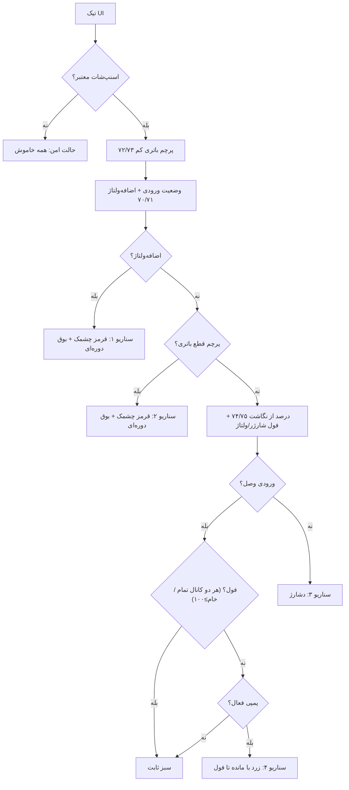
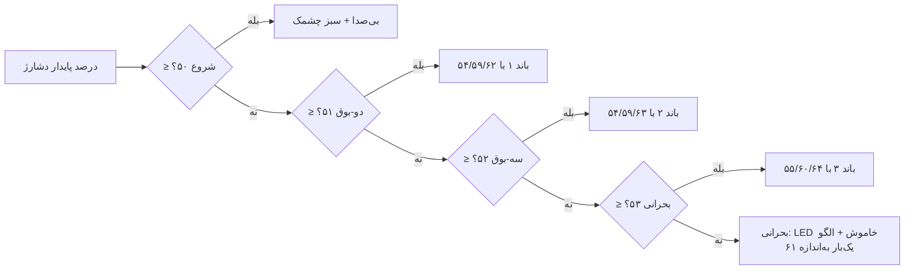

## «صفحه بالا نمی‌آید» — نگهبان، و یک آدرس برای تشخیص (۲۰۲۶-۱۰-۲۷)

کاربر گفت صفحه در مرورگر بالا نمی‌آید. دو کار انجام شد:

- **تغذیهٔ نگهبان حین فرستادن صفحه.** سند پنل حدود ۴۶۸ کیلوبایت است و تکه‌تکه
  فرستاده می‌شود؛ بین تکه‌ها هیچ `yield()` نبود. روی گوشی کند، برد وسط سند
  ری‌استارت می‌شد و مرورگر «هیچ» نشان نمی‌داد. حالا بعد از هر تکه `yield()`
  صدا زده می‌شود.
- **`GET /ping`.** چند بایت که وب‌سرور را از خود سند جدا می‌کند: اگر
  `192.168.4.1/ping` جواب `pong fs=..` بدهد و `/` نیاید، برد سالم است و سند
  مشکل دارد؛ اگر `/ping` هم ساکت باشد، برد در دسترس نیست. این آدرس هیچ بایتی از
  بودجهٔ صفحه را مصرف نمی‌کند.

در همین بررسی، یک تست DOM هم که از قبل قرمز بود درست شد: انتظار تست، درصد
باتری را از قرائت قبلی می‌خواست در حالی که کد درست کار می‌کرد. حالا
`run_esp_tests.sh` این دو تست DOM را هم اجرا می‌کند (اگر node نصب باشد).

## ساعت لاگ همیشه ساعت دستگاه شماست (۲۰۲۶-۱۰-۲۷)

دستور کاربر: «هر وقت با مرورگر به برد وصل شدم، ساعتش با ساعت سیستم آپدیت شود».

- `POST /clock` همیشه برنده است: هر بار صفحه باز یا دوباره فعال شود (و هر ۶۰ ثانیه
  در حالت باز) ساعت دستگاه شما به برد می‌رود (`evtClock`).
- پرش بزرگ (بیش از `ESP_LOG_CLOCK_REWIND_SEC`) بی‌صدا نیست: یک ردیف با بیت
  `ESP_LOG_CHG_CLOCK` نوشته می‌شود و کارت تاریخچه می‌گوید «ساعت با ساعت دستگاه
  شما تنظیم شد»، تا پرش تاریخ در تاریخچه توضیح داشته باشد.
- لنگر ساعت همان لحظه روی آپتایم برد هم بسته می‌شود، پس بین دو اتصال هم ساعت
  درست می‌ماند.

تست: `run_esp_tests.sh` — ۲۹۷ بررسی (بخش `41`: پذیرش ساعت مرورگر و ردیف پرش).

## لاگ بدون مرورگر و بدون قطع شدن (۲۰۲۶-۱۰-۲۷)

کاربر گفت: «صفحه را خودم می‌بندم؛ بعداً می‌آیم و می‌بینم چیزی روی برد ذخیره نشده».
دو علت واقعی پیدا و هر دو رفع شد:

**۱. ساعتِ لاگ به مرورگر بسته بود.** پنل فقط لنگرِ `millis()` خودش را داشت؛ هر
لحظه‌ای که خاموش می‌شد گم می‌شد و فایل‌های روز به گذشته می‌لغزیدند، پس تاریخچهٔ
«امروز» خالی دیده می‌شد. حالا ساعت روی **آپتایم خود STM32** بسته می‌شود (فیلد
آپتایم در `HELLO_ACK`، `esp_link.c:1300`): برد وقتی پنل خاموش است هم می‌شمارد.
پس پنل می‌تواند یک ساعت بی‌برق بماند و باز هم وقتِ واقعی را بداند.
- `func__EspLog_NoteBoardTime()` هر پاسخ HELLO_ACK را می‌گیرد.
- لنگر سه‌فیلدی روی فلش ذخیره می‌شود: ساعت، منطقهٔ زمانی، آپتایم برد.
- ری‌استارتِ خودِ برد هم دیده می‌شود (آپتایم کوچک‌تر) و لنگر تازه بی‌پرش گرفته می‌شود.
- ساعت هیچ‌وقت عقب نمی‌رود (`UINT32_T__G__LogHighWaterSec`).

**۲. فرمتِ خودکار فلش، تاریخچه را پاک می‌کرد.** در `ESP_Calibration.ino` اگر
فایل‌سیستم سوار نمی‌شد، همان‌جا `LittleFS.format()` اجرا می‌شد و همهٔ روزها از بین
می‌رفتند. حالا هیچ فرمتِ خودکاری نیست:
- سوار شدن که شکست بخورد، ردیف‌ها در رم می‌مانند و صفحه `X-Log-Fs: 3` می‌گیرد
  («حافظه سوار نشد — تاریخچه پاک نشده»).
- فرمت فقط با دکمهٔ «فرمت» در همان نوار (`POST /evt/format`) انجام می‌شود.

تست: `run_esp_tests.sh` — ۲۹۲ بررسی. بخش‌های تازه: `38` (بدون هیچ مرورگری ردیف
نوشته می‌شود)، `39` (ساعت پنل با آپتایم برد، ری‌استارت پنل و ری‌استارت برد) و
`40` (فلشِ سوار‌نشده و فرمتِ صریح).

## تاریخچهٔ وضعیت از صفر بازنویسی شد (۲۰۲۶-۱۰-۲۷)

کاربر گفت تاریخچه («لاگ») بالا نمی‌آید. علت با اجرای واقعی کد پیدا شد و بعد کل بخش
`plink_log.h` از صفر بازنویسی شد، نه وصله‌پذیری. طرح تازه این هفت چیز را تضمین می‌کند:

1. **یک مسیر نوشتن.** همهٔ ردیف‌ها فقط از `func__EspLog_AppendRow` می‌گذرند: یک ردیف
   و پایان‌بندش، با تأیید بایت‌های نوشته‌شده. هیچ جای دیگری مستقیم نمی‌نویسد.
2. **ردیفِ ناموفق گم نمی‌شود.** به حلقهٔ رم می‌رود. به‌محض سالم شدن فلش، از
   `func__EspLog_Tick` به فایل روزی برمی‌گردد که **زمان خود ردیف** می‌گوید (نه امروز).
3. **نیمه‌نوشتهٔ قطع برق.** اگر آخرین ردیف پایان‌بند نداشته باشد، ردیف بعدی به آن
   می‌چسبد و هر دو ناخوانا می‌شوند. هنگام باز شدن فایل روز، `RepairTail` فقط یک
   پایان‌بند اضافه می‌کند.
4. **سقف روز به صفحه گفته می‌شود.** یک خانه پیش از سقف، ردیفی با یادداشت `4`
   («سقف پر شد») نوشته می‌شود. روزِ پر دیگر شبیه پنلِ مرده نیست.
5. **ردیفِ دورریخته شمرده می‌شود.** حلقهٔ رم محدود است؛ هر ردیفی که برای ردیف
   تازه‌تر دور ریخته شود در `UINT16_T__G__LogDroppedRows` شمرده و با سرسطر
   `X-Log-Lost` به صفحه داده می‌شود («… ردیف از دست رفت»).
6. **ساعت عقب نمی‌رود.** زمانِ گوشیِ دوم یا ساعت دستی که بیش از
   `ESP_LOG_CLOCK_REWIND_SEC` عقب باشد رد می‌شود تا تاریخچه دو تکه نشود.
7. **فهرست روزها اندازهٔ فایل‌ها را دارد.** پاک‌سازی قدیمی‌ها (`TrimDays`) با همین
   اندازه‌ها کار می‌کند و برای بودجهٔ کل، فایل‌ها را باز نمی‌کند.

پنل سه حالت را از هم جدا می‌بیند (`X-Log-Fs`): `1` ردیف‌ها از فلش، `0` فایل‌سیستم
خاموش، `2` فلش نوشتن را نپذیرفت (نوار قرمز + چند ردیف آخر از رم).

سنجش روی رایانه (یک سناریوی یکسان روی نسخهٔ قبل و بعد):

| حالت | نسخهٔ قبل | نسخهٔ جدید |
|---|---|---|
| فلش پر، یک ردیف بوت | ردیف گم، `/evt` خالی، برچسب «سالم» | ردیف در رم، `/evt` ردیف را می‌دهد، برچسب `2` |
| روز ۴۰ ردیفی، بافر ۳٬۶۰۰ | ردیف‌های ۱۱ تا ۲۸ (جدیدترین‌ها گم) | ردیف‌های ۲۳ تا ۴۰ (تا آخرین ردیف) |

تست: `bash ESP_Calibration/Tester/run_esp_tests.sh` — ۲۶۹ بررسی. چهار بخش تازه همان
تضمین‌های بالا را می‌سازند: `33` و `34` (فلشِ نپذیرفته و روزِ شلوغ)، `35`
(نیمه‌نوشته و تعمیر دنباله)، `36` (سقف روز و ردیف نشانه) و `37` (ساعتِ عقب‌رو).
همین طرح در پنل سادهٔ کاربر (`simple_log.h`) هم پیاده شد.

## سناریوی ترکیبی کاهش مصرف و قدرت آنتن وای‌فای روی باتری

برای کاهش مصرف باتری در زمان قطع برق شهر، مدیریت ترکیبی قدرت آنتن و تغذیهٔ وای‌فای به‌صورت زیر اجرا می‌شود:

- **در زمان وجود برق ورودی (`input_present == true`):** وای‌فای همیشه روشن است و قدرت آنتن روی **بیشترین مقدار (`20.5 dBm`)** قرار دارد.
- **روی باتری (`input_present == false`) و بدون اتصال کاربر:**
  - **۳۰ دقیقهٔ اول (`1800000 ms`):** وای‌فای روشن می‌ماند با **قدرت آنتن پایین (`0.0 dBm`)**.
  - **پس از ۳۰ دقیقه:** چرخهٔ **۱ دقیقه روشن (`60000 ms`) و ۲ دقیقه خاموش (`120000 ms`)** با **قدرت آنتن پایین (`0.0 dBm`)** اجرا می‌شود.
- **به‌محض اتصال کاربر:** وای‌فای روشن می‌ماند، قدرت آنتن روی **بیشترین مقدار (`20.5 dBm`)** تنظیم می‌شود و فریم `0x33` (`ESPLINK_MSG_WIFI_CLIENT_STATE`) برای برد ارسال می‌گردد تا تایمر ۳۰ دقیقه‌ای صفر شود.
- **بازهٔ تماشاگر (v1.112، دستور کاربر ۲۰۲۶-۱۰-۲۵):** «بیشترین توان» فقط **۱۰ دقیقه** (`ESP_WIFI_VIEWER_HOLD_MS`) دوام دارد، چه از لحظهٔ اتصال دستگاه چه از لحظهٔ آخرین درخواست HTTP. اگر تا ۱۰ دقیقه هیچ درخواستی نیاید (گوشی وصل است ولی پنل بسته است)، اکسس‌پوینت **روشن می‌ماند** ولی توان آنتن به `0.0 dBm` می‌افتد و اولین درخواست پنل آن را فوراً برمی‌گرداند. با برق شهر همیشه بیشینه است.
  - چرا: پیش از این، گوشیِ وصل ولی بی‌کار تا بی‌نهایت رادیو را روی `20.5 dBm` نگه می‌داشت؛ یعنی در حالت عادیِ «گوشی در جیب»، برنامهٔ کاهش مصرف باتری هیچ‌وقت اثر نداشت.
  - تست: `ESP_Calibration/Tester/run_esp_tests.sh` (چهار بررسی `handshake/power`)، به‌علاوهٔ همین رفتار در `ESP_USER/Tester/run_simple_tests.sh`.

## قوانین مشترک از میکرو به پنل آمدند (v1.56)

تا پیش از این هر بار یک عدد روی برد ذخیره می‌شد، میکرو **کل مجموعه** را بازبینی
می‌کرد و اگر با هم جور نبودند بی‌صدا عدد دومی را جابه‌جا می‌کرد. آن کار حالا
کار پنل است (دستور کاربر):

- روی برد فقط **کمینه/بیشینهٔ هر فیلد به‌تنهایی** مانده است. این یکی می‌ماند
  چون پنل تنها نویسنده نیست: رکورد NVM نسخهٔ قدیمی یا فریمِ خراب نباید عدد
  خارج از بازه را به تیک‌ها برساند.
- پنل پیش از ارسال (`fixrules`) این قوانین را اعمال می‌کند و در پیام تأیید
  می‌نویسد چه چیزی را جور کرده: کف گپ ۱۰۰ms وقتی بیش از یک بوق هست، جا شدن
  مدت هر بوق در پنجره‌اش، ترتیب باندها (۵۰ ≥ ۵۱ ≥ ۵۲ ≥ ۵۳)، کوچک‌شدن تعداد
  بوق بحرانی تا جا شدن در پنجرهٔ duty، کمینهٔ خاموشی/روشنی زیر دوره، بالا
  کشیدن سطح پاک‌شدن آلارم باتری کم تا آستانه، پهنای دست‌کم ۱۰۰mV نردبان‌های
  درصد (۷۴/۷۵ و ۱۱۹/۱۲۰) و ماندن خروج فول زیر ورود فول.
- شبیه‌ساز سرور پیش‌نمایش هم همین تغییر را گرفت تا دروغ نگوید.
- صرفه‌جویی اندازه‌گیری‌شدهٔ فلش STM32: **۶۰۶ بایت** (۷۹۱۸۱ → ۷۸۵۷۵ با
  ابزار zig/LLVM؛ عدد نسبی معتبر است).

## چیدمان و رفتار کارت‌ها (v1.55)

- **شبیه‌ساز هر کارت رفت بالای همان کارت**، بلافاصله پیش از بخش ۱ تنظیمات؛ قبلاً
  جای بعضی‌ها وسط و بعضی‌ها آخر کارت بود.
- **کادر «فاصلهٔ بین بوق‌ها» با یک بوق خاموش می‌شود**: وقتی تعداد بوقِ آن باند ۱
  است، گپ معنا ندارد، پس کادر غیرفعال و کم‌رنگ می‌شود و نمی‌شود رویش نوشت.
  گپ مشترک (۶۵) تا وقتی یکی از باندهای ۱/۳/بحرانی بیش از یک بوق بخواهد روشن
  می‌ماند.
- **شبیه‌ساز عدم‌توازن دو ولوم گرفت**: ولتاژ نیم‌باتری بالا و پایین. اختلافشان با
  «حد اختلاف» سنجیده می‌شود، رویدادها شمرده می‌شوند و در شمارهٔ تعیین‌شده قفل
  می‌کند (قرمز ثابت + بوق دوره‌ای). دکمهٔ «شروع دوبارهٔ شمارش» شمارنده را صفر
  می‌کند. زمان باقی‌مانده تا رویداد بعدی هم نوشته می‌شود.
- **نوار توضیح بالای تب و دکمهٔ میوت حذف شدند** (دستور کاربر).

## وقتی کسی تماشا نمی‌کند، برد را بی‌خود مشغول نکن (v1.54)

ESP هر ۳۰ ثانیه یک `GET_PARAMS` می‌فرستاد و برد کل جدول ۱۲۳ مقداری را پاسخ
می‌داد — حتی وقتی هیچ مرورگری باز نبود. این نوسازی فقط برای «راست نگه داشتن
صفحه‌ای که کسی می‌بیند» وجود داشت، و حالا که چراغ‌های زندهٔ برد از پنل حذف
شده‌اند، بی‌مرورگر هیچ مصرفی ندارد. از v1.54 تا وقتی `/t` خوانده نشود
(`ESP_LINK_BROWSER_LOST_MS` = ۱۰ ثانیه) نوسازی انجام نمی‌شود؛ اولین poll بعد از
وقفه دوباره آن را مسلح می‌کند، پس هرکس صفحه را باز کند باز هم مقدار تازه
می‌بیند. نتیجه: در حالت عادی (پنل بسته) هیچ ترافیک پارامتری روی لینک نیست و
STM32 کاری برای آن انجام نمی‌دهد.

## حذف نوار چراغ‌های زندهٔ بالای صفحه (v1.53)

نوار چسبانِ بالای تب سناریوها که سه LED و بازر و زیرنویس زندهٔ برد را نشان
می‌داد حذف شد (دستور کاربر): شبیه‌ساز هر کارت کار آن را بهتر انجام می‌دهد و
این صفحه ابزار راه‌اندازی است، نه داشبورد. با آن، موتور `uview` که هر ۵۰ms
کل منطق تیک برد را از روی تله‌متری بازپخش می‌کرد هم رفت؛ آنچه ماند فقط آینهٔ
بیت‌های خطا و تازه‌سازی اعداد کارت‌ها با دورهٔ ۲۵۰ms است. دکمهٔ میوت سر جایش
ماند. نتیجه: حجم HTML پنل از ۲۶۴٫۶ به ۲۵۸٫۸ کیلوبایت و بار CPU مرورگر کمتر.

## یک کلید سراسری برای ارسال تنظیمات (v1.52)

تا پیش از این هر کادر به‌محض خروج از فوکوس خودش را روی برد می‌فرستاد؛ یعنی
ده‌ها ارسال تک‌تک و بدون هیچ تأییدی. حالا:

- ویرایش‌ها فقط **محلی صف** می‌شوند؛ کادر ویرایش‌شده حاشیهٔ نارنجی می‌گیرد و
  کنارش می‌نویسد «در صف». دکمه‌های «بازگردانی پیش‌فرض» هم به همین صف می‌روند.
- یک نوار ثابت پایین صفحه تعداد تغییرهای ارسال‌نشده را نشان می‌دهد با دو دکمه:
  **ارسال همهٔ تغییرات به برد** و **لغو و برگرداندن از برد**.
- بعد از ارسال، پنل منتظر فریم بعدی تله‌متری می‌ماند و مقدار برگشتی هر شناسه را
  با مقدار فرستاده‌شده می‌سنجد، سپس یکی از این پیام‌ها را می‌دهد:
  «✅ N تنظیم ارسال شد؛ برد همه را عیناً پذیرفت و ذخیره کرد»، یا «✅ N نشست، اما
  برد M مقدار را گیره زد: 39: 60→50»، یا «⛔ هیچ‌کدام ارسال نشد».
- کلیدهای آنی (قطع PWM، کالیبراسیون با مولتی‌متر، بی‌صداکردن) عمداً بیرون از صف
  ماندند، چون خودشان یک عمل فوری و آگاهانه‌اند.

### استقلال اعداد کارت دشارژ

هر ۲۵ عدد قابل‌نوشتن کارت دشارژ (۵۰..۶۷، ۷۴، ۷۵، ۸۰..۸۲، ۱۲۱، ۱۲۲) یک کلمهٔ
جداگانه در `ui_alarm_t` دارند، با همان شناسه روی لینک ست/گت می‌شوند، در NVM
ذخیره می‌شوند و همگی در `ui_led.c` واقعاً مصرف می‌شوند — هیچ‌کدام تزئینی یا
مشترک با دیگری نیست (ممیزی v1.52).

## شبیه‌ساز زندهٔ هر سناریو (v1.51)

سه LED و بازرِ بالای هر کارت دیگر از برد خوانده نمی‌شوند. این پنل ابزار
«راه‌اندازی اولیهٔ برد» است، نه داشبورد کاربر؛ پس چیزی که باید ببینید این است
که «با عددهایی که همین الان دارم تایپ می‌کنم، برد چه کار خواهد کرد».

- هر کارت یک جعبهٔ «شبیه‌ساز این سناریو» دارد: سه چراغ (قرمز/سبز/زرد)، یک
  نشانهٔ بازر و یک خط توضیح، به‌علاوهٔ دکمهٔ توقف/ادامه.
- همهٔ چهره‌ها با ساعت خود مرورگر (هر ۶۰ms) و با همان حساب فرمور ساخته
  می‌شوند: دوره × duty برای چشمک، و «تعداد × مدت + گپ» برای بوق.
- کارت‌های ۳ و ۴ یک اسلایدر درصد و کارت ۵ یک اسلایدر ولتاژ دارند تا بتوانید
  باندها و آستانه‌ها را بدون باتری واقعی جابه‌جا کنید.
- کارت ۵ چهرهٔ LED جدا ندارد؛ فقط پرچم آلارم را با بازهٔ ضدلرزش نشان می‌دهد.
- چون هیچ داده‌ای از برد لازم نیست، شبیه‌ساز آفلاین هم کار می‌کند.

## طراحی (v1.16f)

سیستم دیزاین یکدست تیره (تک‌فایل آفلاین، بدون وابستگی خارجی):
توکن‌های CSS (`--bg/--cd/--in/--rs/--ln/--tx/--mu` + آکسی `--ac` و
معنایی `--ok/--wa/--er`)؛ هدر شیشه‌ای چسبان با نشان وضعیت لینک؛ تب‌های
سگمنتی با قرص فعال؛ کارت‌ها با سایهٔ نرم و نوار آکسی کنار تیتر؛ دکمه‌ها
و ورودی‌ها هم‌ارتفاع (۳۶px) با حلقهٔ فوکوس؛ تگ‌های وضعیت نقطه‌دار؛ نوار
LED چسبان با پس‌زمینهٔ مات؛ نمودارها با بوردر و لجند خواناتر (ارتفاع
۱۶۰px). رنگ‌های هاردکد JS (خطوط canvas، نمودار SVG مراحل، نوارهای
آستانه، بوردر خطای نگهبان) با همین پالت یکدست شدند. رفتار/شناسه‌ها/
کلاس‌ها دست‌نخورده — فقط لایهٔ دیداری عوض شده است.

## تب‌ها

| تب | محتوا |
|---|---|
| پنل (۰) | ولتاژها، وضعیت لینک، دو کانال شارژر (مرحله/جریان/duty)، فرمول‌ها، نمودار مراحل شارژ + جدول یکی شده ولتاژ و وضعیت آلارم؛ تعداد نقاط هر نمودار جریان زیر همان نمودار قابل تنظیم است |
| داده‌برداری بنچ (۱) | ویزارد دستی ثبت بنچ + ابزارها (همه دستی؛ هیچ ضریبی خودکار ارسال نمی‌شود)؛ با تیک `SWEEP` فقط سه کادر از/تا/گام دیده می‌شود و بدون تیک فقط فهرست duty دستی دیده می‌شود؛ شروع با فایل قبلی = پنجره مودال «دانلود و ادامه» یا «پاک و تازه» |
| تنظیمات (۲) | پنج زیرتب |

زیرتب‌های تنظیمات:

| زیرتب | محتوا |
|---|---|
| شارژ و PID (s0) | نمودار مراحل شارژ با راهنمای رنگ بیرون از کادر + کارت PID دوحلقه‌ای (۱۷ ضریب ۷۷..۹۲ + به‌علاوهٔ فیلتر ولتاژ ۹۹) + ۱۳ تراشهٔ حد زیر نمودار در سه دستهٔ «رسیدن نرم به هدف» (duty step، hyst، V filter)، «ترمز اضطراری و حاشیهٔ امن» (Backstop gain I/V، margin) و «تصمیم‌های زمانی» (هفت تایمر ماشین حالت) + یک کلید بازگردانی کارخانه برای کل محدوده |
| سناریوها (s1) | هدر چسبان آینه + انتخاب‌گر ۶ کارت هم‌شکل (۲۷..۸۲ و ۱۰۸..۱۱۸) + نگهبان خودش + دکمهٔ پیش‌فرض سناریوها |
| نظارت و ایمنی (s2) | کارت‌های ۲۷..۳۷ (نظارت باتری، پنجرهٔ ورودی، سقف‌ها) + نگهبان خودش + دکمهٔ پیش‌فرض خودش |
| کالیبراسیون و فیلتر جریان (s3) | پنجره‌های فیلتر جریان ۷/۸ + کالیبراسیون جریان ۰..۳ و ۹..۱۰ |
| پشتیبان‌گیری (s4 — آخرین زیرتب) | فقط کارت بکاپ سراسری ۱۰۲تایی |

کارت یکی شده ولتاژها و وضعیت آلارم (v1.16k): یک جدول ثابت ۷ ردیفه (ورودی، پک، نود، دو باتری، دو جریان) که هر مقدار فقط یک بار با قرص وضعیت کنارش نشان داده می شود؛ چیدمان ثابت است و با تغییر متن به هم نمی ریزد. کالیبره مولتی متر هر سه ولتاژ اول در همان ردیف است. جعبه fault با LED جدا برای هر بیت + نقطه زنده سر جایشان هستند و هر فریم به روز می شوند.
هر ۴ نوار آستانه حذف شدند (ورودی در v1.16i، سه تای دیگر با عنوان هایشان در v1.16j)؛ فقط باکس ها ماندند.

نام‌گذاری یکدست انتخاب‌گر سناریو: ۱ · اضافه‌ولتاژ، ۲ · قطع باتری،
۳ · دشارژ، ۴ · شارژ عادی، ۵ · عدم‌توازن، ۶ · باتری خراب، ۷ · خطای فنی برد،
۸ · باتری ضعیف.

### هشت کارت سناریو — یک قالب مشترک (v1.43 برای شارژ، v1.44 برای بقیه)

هر هشت کارت حالا یک شکل دارند و سه چیز را با هم می‌دهند:

1. **جعبهٔ «این سناریو کِی می‌آید؟»** — شرط ورود، شرط خروج (و اینکه هیسترزیس کجاست) و چهرهٔ LED/بوق.
2. **بخش‌های شماره‌دار تنظیم** — آستانه‌ها، چشمک و بوق هرکدام جدا، نه یک ردیف طولانی.
3. **خط‌های محاسبه‌شده زیر هر بخش** — همان عددی که برد به‌کار می‌برد، از مقدار «تایپ‌شده یا اعمال‌شده»، با همان ترتیب گام‌های فرمور. هیچ منطقی در پنل ساخته نشده است.

| کارت | چه چیزی اضافه شد |
|---|---|
| ۱ · اضافه‌ولتاژ | ورود/خروج بر حسب mV (آستانه و آستانه − hysteresis)، میلی‌ثانیهٔ روشن/خاموش قرمز از دوره×duty، پنجرهٔ بوق (مدت×تعداد+گپ‌ها) با سکوت بین دو الگو و هشدار «در دوره جا نمی‌شود» + نقطهٔ قرمز زنده |
| ۲ · قطع باتری | دو تشخیص جدا (قطع حین شارژ با دبانس، غیبت/بازگشت با دبانس‌ها) + فاصلهٔ mV غیبت تا بازگشت + اعداد چشمک و الگوی بوق + نقطهٔ قرمز زنده |
| ۳ · دشارژ (v1.45/v1.47) | **صاحب** حد پایین/بالای ولتاژ (بقیهٔ کارت‌ها فقط نمایش می‌دهند) + **یک بلوک برای هر باند**: سقف درصد، تعداد بوق، مدت، فاصلهٔ تکرار و گپِ همان باند کنار هم، و زیر هر بلوک بازهٔ درصد/ولتاژ، سبز روشن/خاموش در میانهٔ باند و پنجرهٔ بوق با «در فاصله جا می‌شود؟». بلوک بحرانی جدا و قرمزرنگ است + خط ترتیب باندها + نقطهٔ سبز زنده |
| ۴ · شارژ عادی | تعریف فول و جدول چشمک زرد (پایین‌تر) |
| ۵ · باتری کم | تصریح اینکه LED اختصاصی ندارد و فقط پرچم است + معادل درصدیِ آستانه و سطح پاک‌شدن روی نردبان ۷۴/۷۵ (تا با باندهای دشارژ هم‌تراز شود) + هشدار «پاک‌شدن زیر آستانه» |
| ۶ · عدم‌توازن | پنج گام روند (اندازه، گیت زمانی، رویداد، قفل، بعد از قفل) + خط گیت/پایداری و خط قفل با «کمترین زمان ممکن تا قفل = سقف رویداد × پایداری» |
| ۷ · خطای فنی برد | چهار عدد بوق و دو عدد چشمک سه‌LED مستقل + خلاصهٔ الگو و «در دوره جا می‌شود؟» |
| ۸ · باتری ضعیف (v1.86) | زمان‌بندی تشخیص/استراحت/بازیابی، چراغ قرمز چشمک‌زن با دوره و سهم مستقل، بوق مستقل، کلید بستن خروجی + **خط وضعیت زندهٔ حکم** و چراغ همیشه‌سوار «باتری ضعیف» در نوار خطاها؛ کلیک روی چراغ کارت ۸ را باز می‌کند. از v1.87 دکمهٔ **«پاک‌کردن حکم»** هم دارد (مثل کارت‌های ۵ و ۶): `POST /latch/reset?n=8` شناسهٔ ۲۰۴ را در صف می‌گذارد و پس از پژواک، خط وضعیت «پاک شد» می‌گوید |

### سناریوی ۸ و تفاوت «خالی» با «فرسوده» (v1.88)

کارت ۸ یک عدد تازه گرفت: **ولتاژ استراحت لازم (mV)**، پیش‌فرض ۲۵٬۰۰۰. اگر
باتری پیش از وصلِ بدون برق شهر استراحت کمتری داشته باشد، «خالی» حساب
می‌شود: **وصل نمی‌شود** و حکمی هم زده نمی‌شود؛ تا برگشت برق شهر بسته
می‌ماند. اگر استراحت به این عدد رسید، یک بار وصل می‌شود و قطعِ دوباره یعنی
باتری فرسوده. چهرهٔ قرمز
چشمک‌زن هم فقط وقتی برق شهر نیست دیده می‌شود؛ با برگشت برق شهر چراغ شارژ
عادی است و حکم در پس‌زمینه می‌ماند.

از v1.90 سقفِ تلاشِ بدون برق شهر **یک** است (پیش‌تر سه بود): اگر همان یک وصل
دوباره قطع شود، مسیر تا برگشت برق شهر بسته می‌ماند. آستانهٔ استراحت هم یک
قانون محافظت از باتری است، نه بخشی از سناریو: خاموش‌کردن «حکم فعال» (شناسهٔ
۱۴۷) فقط نمایش حکم را برمی‌دارد و کاری با آستانهٔ استراحت یا سقف تلاش ندارد.
در حالت قطعِ بدون برق شهر، همهٔ چراغ‌ها و بوق خاموش می‌مانند و قطع سیم باتری
در همین حالت هیچ آلارمی نمی‌دهد.

### تیک «فعال» هر کارت، از v1.87 روی برد هم اثر دارد

پیش از این نسخه، تیک «فعال» بالای هر کارت فقط در همین مرورگر کار می‌کرد
(کارت کم‌رنگ و کنترل‌هایش قفل می‌شد) و هیچ چیز به برد نمی‌رفت. حالا تیک
کارت‌های ۱ تا ۷ شناسهٔ خودش را می‌فرستد (۱۵۸..۱۶۴) و برد **فقط چراغ و بوق
همان سناریو** را خاموش یا روشن می‌کند:

- تشخیص، قفل‌شدن و محافظت‌ها دست نمی‌خورند؛ فقط هشدار ساکت می‌شود.
- ۰ = ساکت، ۱ = روشن (پیش‌فرض). مقدار در فلش می‌ماند و بعد از ری‌استارت هم
  همان است.
- کارت ۸ (باتری ضعیف) چنین کلیدی ندارد و تیک آن همچنان فقط ظاهر کارت را
  تغییر می‌دهد.

### «چه وقت پاک می‌شود؟» در هر هشت کارت (v1.87)

هر کارت سناریو یک نوار سبز کوتاه دارد که با فارسی ساده می‌گوید همان خطا با چه
چیزی از بین می‌رود — مثلاً اضافه‌ولتاژ با برگشتن ورودی به «آستانه − hysteresis»،
قطع باتری با رسیدن هر دو نیم به «آستانهٔ بازگشت» به‌مدت «دبانس بازیابی»،
عدم‌توازن و باتری خراب فقط با تعویض باتری یا کلید ریست، خطای فنی فقط با ریست
برد، و باتری ضعیف با استراحت سالم، خاموش‌کردن «حکم فعال» یا کلید ریست.

### بازبینی منطق (۲۰۲۶-۱۰-۲۳)

یک ایراد منطقی واقعی پیدا و رفع شد: **ولتاژ استراحت** باتری هم وقتی برق شهر
حاضر بود اندازه‌گیری می‌شد. در آن حالت شارژر همان پک را شارژ می‌کند و ولتاژ
پایانه تا حدود ۲۷ ولت بالا می‌رود، پس یک چشمک کوتاه برق شهر «استراحت ۲۵ ولت
یا بیشتر» جعل می‌کرد: پکِ خالی بدون برق شهر روی بار برمی‌گشت، همان‌جا فرو
می‌ریخت و حکم کاذب «باتری فرسوده» می‌گرفت. حالا استراحت یعنی نه بار و نه
شارژ - فقط نمونه‌های بدون برق شهر شمرده می‌شوند. تست خودکار همین مورد هم
اضافه شد: قطع در ۲۰٫۸ ولت، ۲۰ ثانیه برق شهر با ۲۷ ولت، بعد نشستن پک روی
۲۳ ولت => مسیر بسته می‌ماند و حکمی زده نمی‌شود.

همچنین «خروج از صفر درصد» کمینه‌اش ۱ شد: با صفر، شرط «درصد خام ≥ آستانه»
همیشه درست بود و درصد بین ۰ و ۱ می‌پرید، باند بحرانی هر بار بوق یک‌بارهٔ ده
ثانیه‌ای را از نو مسلح می‌کرد.

### بازبینی اعداد پنل با برنامه (۲۰۲۶-۱۰-۲۳)

پنج عدد در متن‌ها و بازه‌های پنل با برنامه یکی نبود و اصلاح شد. متن‌ها هم
همان‌جا ساده‌تر شدند تا کسی گمراه نشود:

- سقف «Hard fault جریان» در پنل ۹۵۰ بود؛ سقف واقعی برنامه ۳۰۰۰ است
  (۹۵۰ فقط پیش‌فرض کارخانه است و جابه‌جا نشد). حالا می‌شود تا ۳۰۰۰ تنظیم کرد.
- گام تغییر و فیلتر ولتاژ می‌گفتند «تیک ۵۰ میلی‌ثانیه‌ای»؛ تیک واقعی
  ۱۰۰ میلی‌ثانیه است (مثال ۸ پرمیل هم با آن حساب شد: ۱۰۰ پرمیل ≈ ۱٫۳ ثانیه).
- «مهلت وقفه‌ای که ساعت را صفر می‌کند» می‌گفت پیش‌فرض ۱۰ دقیقه؛ پیش‌فرض
  واقعی ۱ دقیقه (۶۰٬۰۰۰ میلی‌ثانیه) است.
- توضیح حکم «باتری خراب» هنوز «قرمز ثابت» می‌گفت؛ چراغ و بوق این حکم از
  عددهای مستقل خودش می‌آید.
- متن «چراغ‌ها و بوق خاموش» فقط ولتاژ ۲۱٬۰۰۰ را می‌گفت؛ حالا هر بسته‌بودن
  مسیر باتری بدون برق ورودی را می‌گوید (ولتاژ پایین، حکم باتری ضعیف، قطع سیم).

عددهای پیش‌فرض که پنل وقتی هنوز چیزی از برد نرسیده نشان می‌داد هم با جدول
کارخانه یکی شد: آستانهٔ اضافه‌ولتاژ ۲۸٬۰۰۰ (نه ۲۹٬۰۰۰)، hysteresis آن ۱٬۰۰۰
(نه ۵۰۰) و گپ بوق اضافه‌ولتاژ ۰ (نه ۵۰۰).

### کادر خطاها و وضعیت‌های زنده (v1.94)

چراغ‌های همیشه‌روشنِ بالای جدول برداشته شدند (دستور کاربر): همان چیزها یک
بند پایین‌تر، داخل کادر خطاها، دوباره نوشته می‌شدند و جای صفحه را می‌گرفتند.
جای آن‌ها، خودِ کادر حالا دو بخش دارد:

- **خطاها** — همان چراغ‌های قفل‌شدهٔ برد، هر بیت یک چراغ. سه چراغی که کارت
  سناریو دارند (قطع باتری، فنی برد، قفل عدم‌توازن و باتری خراب) کلیک‌پذیر
  مانده‌اند و تنظیمات همان سناریو را باز می‌کنند.
- **وضعیت‌ها — همین حالا** — برق شهر وصل است یا قطع، هر کانال در چه مرحله‌ای
  از شارژ است، مسیر باتری وصل است یا بسته، استراحت حرارتی، حکم‌های قفل‌شده،
  مود دستی، و این‌که دادهٔ برد کامل رسیده یا نه. همه با یک نگاه، بدون رفتن
  به تب دیگر.

کارت سناریوی ۸ تیک «فعال» بالای کارت را داشت که روی برد هیچ کاری نمی‌کرد؛
کلید واقعی این سناریو همان تیک «حکم باتری ضعیف فعال باشد» است. تیک اضافه
برداشته شد و جمله‌اش سر جایش آمد تا کسی دنبال کلید دوم نگردد.

### تاریخچهٔ وضعیت — وضعیت باتری در هر خط و ثبتِ هر بالا آمدن (v1.109)

- **وضعیت باتری در هر خط:** هر خط تاریخچه حالا کنار رویدادش، وضعیت باتری را هم
  می‌گوید: **درصد باتری**، **حالت** (دشارژ / شارژ — با نام مرحلهٔ شارژ / برق وصل
  بدون شارژ) و **توان باتری بر حسب وات**. درصد از نگاشتِ دشارژ (پارامترهای ۷۴/۷۵،
  کارخانه ۲۱٬۰۰۰..۲۹٬۰۰۰ میلی‌ولت) حساب می‌شود و از این نسخه **ستونِ آخرِ خودِ
  فایل** (`batt_pct`) هم هست تا اگر نگاشت بعدا تنظیم شد، تحلیلِ بعدی همان مقیاسِ
  لحظهٔ ثبت را داشته باشد. فایل‌های قدیمی بدون این ستون باز می‌شوند و درصدشان
  از روی ولتاژ همان خط بازسازی می‌شود.
- **هر بالا آمدن در دشارژ ثبت می‌شود:** وقتی برق شهر قطع است، هر پلهٔ **بالا** آمدنِ
  ولتاژ پک (۲۰۰ میلی‌ولت یا بیشتر نسبت به خط قبلی) حتی داخل یک دقیقه، خطِ خودش را
  می‌نویسد. محدودیتِ «یکی در دقیقه» فقط برای **پایین‌رفتن** و برای **شارژ** می‌ماند
  تا نوسانِ بار یا سوئیچینگِ شارژر لاگ را پر نکند. ادغامِ ۲ ثانیه‌ایِ پرش‌های تند
  سر جایش است.

### تاریخچهٔ وضعیت — جزئیات بیشتر، ضربان، و سقف حجم (v1.96)

هدف لاگ این است که بشود از روی آن فهمید چه اتفاقی افتاده و برد درست کار کرده یا
نه. سه چیز برای همین اضافه شد:

- **ستون‌های تازه در هر خط:** ولتاژ ورودی، ولتاژ نود ۱۲ ولت، جریان هر دو باتری و
  درصد فرمان (duty) هر دو کانال، در کنار ولتاژ پک و دو نیم‌باتری. حالا هر خط
  به‌تنهایی می‌گوید در آن لحظه چه ولتاژی کجا بوده و برد چه فرمانی می‌داده.
- **گام ولتاژ پک:** ولتاژ پک با هر پلهٔ **۲۰۰ میلی‌ولتی** یک خط می‌سازد (نسبت به
  ولتاژ آخرین خط، نه فریم قبلی) تا منحنی شارژ و افت باتری در لاگ دیده شود؛
  لرزش‌های کوچک‌تر خط نمی‌سازند.
- **خط ضربان:** اگر **ده دقیقه** هیچ اتفاقی نیفتد، یک خط «ضربان» نوشته می‌شود.
  تفاوت «چیزی عوض نشده» با «پنل از کار افتاده» همین است: تاریخچهٔ خالی با برد
  مرده اشتباه نمی‌شود.
- **سقف حجم، نه فقط سقف روز:** تعداد روز به‌تنهایی فلش را کران‌دار نمی‌کند، چون
  یک روز شلوغ از یک هفتهٔ آرام بزرگ‌تر است. کل تاریخچه داخل یک بودجهٔ بایتی
  نگه داشته می‌شود (۲۰۰ کیلوبایت در پنل فنی، ۱۲۰ کیلوبایت در پنل ساده) و وقتی
  از آن بگذرد، **اول قدیمی‌ترین روز** حذف می‌شود. پر شدن حافظه دیگر نمی‌تواند
  ثبت را بخواباند.
- **ذخیره هرگز منتظر ساعت نمی‌ماند (v1.97):** تا وقتی گوشی وصل نشده، خط‌ها در فایل
  روزِ «بدون ساعت» نوشته می‌شوند و همان فایل هم در فهرست روزها می‌آید؛ به‌محض
  اولین اتصال، ساعت گرفته می‌شود و از آن به بعد خط‌ها در فایل روزِ واقعی می‌نشینند.
  فایل قبلی پاک نمی‌شود. فایل‌های قدیمی که ستون‌های تازه را ندارند هم بدون مشکل
  باز می‌شوند.

### پیش‌شرط‌های مود تست دستی، زنده (v1.100)
این فهرست فقط در حالت دستی دیده می‌شود؛ در حالت خودکار پنهان است.

کنار کنترلِ هر کانال، فهرستِ پیش‌شرط‌های مود تست دستی نشان داده می‌شود: لینک،
برق ورودی، فعال‌بودن کانال‌ها از پنل، نبودِ قفلِ خرابیِ فنی، نبودِ خطای نهایی،
و نبودِ خطای قفل‌شده. هر کدام وقتی درست باشد تیک سبز می‌گیرد و وقتی غلط باشد
با رنگ هشدار، دلیلِ فارسی‌اش را می‌گوید. دکمهٔ «دستی» هم تا سبزنشدنِ همه وارد
نمی‌شود و همان دلایل را نشان می‌دهد.

### لاگ حتی بدون برد هم می‌نویسد (v1.106)

- خط «راه‌اندازی» در همان لحظهٔ بالا آمدن پنل نوشته می‌شود؛ لازم نیست برد وصل باشد.
- اگر برد وصل نباشد، پس از ۵ ثانیه یک خط «ارتباط قطع است» ثبت می‌شود - حتی اگر برد
  هیچ‌وقت وصل نشده باشد - و بعد هر ۶ ساعت یک «گزارش دوره‌ای» می‌آید تا معلوم شود
  پنل زنده بوده و می‌نوشته.
- با وصل‌شدن دوبارهٔ برد، یک خط «ارتباط برقرار شد» نوشته می‌شود؛ جفت خط‌های
  قطع/برقرار در تاریخچه می‌مانند.
- ذخیرهٔ هر خط همچنان فوری است؛ هیچ خطی منتظر ساعت یا منتظر برد نمی‌ماند.
- از v1.104 کارت «تاریخچهٔ وضعیت» فقط در صفحهٔ اول («پنل») است.

### استراحت حرارتی و کامل‌شدن کلیدهای کارخانه (v1.102 تا v1.106)

- سه عدد استراحت حرارتی (آستانهٔ جریان، مدت شارژ تا استراحت، طول استراحت؛ شناسه‌های
  ۱۶۶..۱۶۸) از v1.102 در تب «شارژ و PID» زیر نمودار شارژ تنظیم می‌شوند. آستانه از
  v1.103 با پیش‌فرض واقعی `600mA` بالا می‌آید (۵۰ کمتر از سقف کارخانهٔ `650mA`)، نه
  صفر. صفر در هر دو زمان یعنی استراحت حرارتی خاموش (v1.105) و استراحتِ در حال
  اجرا تا آخرش تمام می‌شود.
- از v1.106 بازگردانی پیش‌فرض کامل شد: ۱۳ کلید، یکی زیر هر کارت و هر گروه -
  تنظیمات شارژ (شامل همان سه عدد حرارتی)، هشت کارت سناریو، نظارت و ایمنی، وای‌فای
  و مصرف باتری، فیلتر جریان و کالیبراسیون. بازگردانی هر کارت سناریو، تیک «فعال»
  آن را هم با مقدار پیش‌فرض همگام می‌کند.

- از v1.108 ردیفِ «برق شهر قطع/وصل شد» حداکثر **۲۵۰ میلی‌ثانیه** بعد نوشته می‌شود،
  نه پشت پنجرهٔ ادغام ۲ثانیه‌ای؛ پس اگر برد همان لحظه برق پنل را ببرد (صرفه‌جویی
  باتری)، قطعِ برق شهر همیشه در تاریخچه می‌ماند. پرش‌های تند هنوز در یک ردیف ادغام
  می‌شوند.

### نوشته‌های لاگ روشن شد (v2.00)

نام‌های مبهم کنار رفتند و هر عدد حالا با همان اسمی نوشته می‌شود که بقیهٔ صفحه
به کار می‌برد: «ولتاژ پک»، «نیم‌باتری پایین/بالا»، «اختلاف دو نیم‌باتری»،
«ولتاژ ورودی»، «نود ۱۲ ولت»، «جریان کانال ۱/۲» و «فرمان کانال ۱/۲». نام‌های
مبهم دیگر هم روشن شدند: «ضربان» شد «گزارش دوره‌ای»، «حکم» شد «نتیجه»، و نام
مراحل شارژ و خطاها یک‌دست و خوانا شد. فقط شکل نمایش عوض شده؛ متن و اعداد
ذخیره‌شده در فایل‌ها همان است.

### تاریخ‌های لاگ، شمسی (v1.99)

هر تاریخی که تاریخچهٔ وضعیت نشان می‌دهد - فهرست روزها، خط بالای کارت، و نام فایل
دانلود - تاریخ ایرانی (شمسی) است، نه میلادی. هر تکه از متن هر خط هم در قالب خودش
می‌نشیند و عدد و واژهٔ انگلیسی جدا نگه داشته می‌شوند تا متن راست‌به‌چپ قاطی نشود.

### تاریخچهٔ وضعیت — لاگ خودش را پر نمی‌کند (v1.98)

- **مرز «نزدیک قطع» حالا هیسترزیس دارد:** باتری زیر **۲۱٬۲۰۰ میلی‌ولت** وارد این
  مرز می‌شود و فقط بالای **۲۱٬۴۰۰ میلی‌ولت** از آن بیرون می‌رود. باتری‌ای که روی
  مرز می‌لرزد یا باری که روشن و خاموش می‌شود، دیگر هر لحظه یک خط تکراری
  نمی‌نویسد.
- **گام ولتاژ سقف زمانی گرفت:** از گام ولتاژ، حداکثر **یک خط در دقیقه** نوشته
  می‌شود. شارژ آرام همچنان منحنی‌اش را می‌کشد، اما نوسان بار لاگ را پر نمی‌کند.
  خطی که به هر حال برای اتفاق دیگری نوشته می‌شود، ولتاژ همان لحظه را هم دارد.
- **چراغ «باتری ضعیف» در کادر خطاها:** حکم باتری ضعیف هم مثل بقیهٔ قفل‌ها حالا
  چراغ خودش را در کادر خطاهای صفحهٔ اول دارد و با کلیک روی آن، تنظیمات سناریوی
  باتری ضعیف باز می‌شود.

### تاریخچهٔ وضعیت — همهٔ وضعیت‌ها، با رنگ (v1.95)

کارت پایین صفحه حالا هر چیزی را که برد می‌گوید ثبت می‌کند، نه فقط خطاها:

- برق شهر، مرحلهٔ شارژ هر کانال، اجازهٔ کار هر شارژر، مود دستی، رسیدن و
  معتبر بودن دادهٔ برد
- بیت‌های خطا، و قفل‌ها و حکم‌ها: قفل عدم‌توازن، حکم باتری ضعیف و حکم
  باتری خراب (با نام همان باتری)
- قطع و وصل مسیر باتری، استراحت حرارتی، نزدیک‌شدن باتری به مرز قطع
- رسیدن و معتبر بودن دادهٔ برد، و قطع و برگشت ارتباط

هر خط یک نوار رنگی کنارش دارد تا با یک نگاه معلوم شود چه اتفاقی افتاده:
قرمز برای خطا و قفل، نارنجی برای هشدار (قطع برق شهر، قطع ارتباط، مود دستی)،
سبز برای برگشت به سلامتی، و خاکستری برای تغییر سادهٔ وضعیت. بالای فهرست هم
سه شمارنده می‌گوید در این روز چند خطا، چند هشدار و چند برگشت به سلامتی داشته‌ایم.
جدیدترین اتفاق بالای فهرست می‌آید و روز پیش‌فرض، همان امروز است.

### تاریخچهٔ وضعیت — لاگ روزانهٔ تغییرها (v1.93)

پایین صفحه، بیرون از تب‌ها، یک کارت «تاریخچهٔ وضعیت (لاگ)» هست: می‌گوید برد از
وقتی پنل باز شده چه وضعیت‌هایی را گذرانده است.

- **چه چیزی ثبت می‌شود:** برق شهر (آمد/رفت)، مرحلهٔ شارژ هر دو کانال، خطاها،
  قفل‌ها و حکم‌ها، قطع و وصل مسیر باتری، استراحت حرارتی، نزدیک‌شدن باتری به مرز
  قطع (۲۱٬۲۰۰ میلی‌ولت)، قطع و برگشت ارتباط با برد، و روشن‌شدن دوبارهٔ پنل.
- **فقط تغییر:** تا چیزی عوض نشود هیچ ردیفی نوشته نمی‌شود؛ برد آرام فلش را
  نمی‌ساید. چند تغییر پشت‌سرهم داخل دو ثانیه در یک ردیف ادغام می‌شوند (ردیف همیشه
  کل وضعیت را دارد، پس وضعیت نهایی گم نمی‌شود).
- **ذخیرهٔ روزانه:** هر روز یک فایل روی حافظهٔ خود پنل، به تاریخ همان گوشی؛
  **۳۰ روز** نگه داشته می‌شود و بعد قدیمی‌ترین حذف می‌شود (سقف ۴۰۰ ردیف در روز).
- **گم نشدن در قطع باتری:** هر ردیف همان لحظه نوشته و بسته می‌شود، پس اگر پنل
  سرِ قطع باتری برق را از دست بدهد، آخرین ردیف از قبل روی فلش است. ردیف اول بعد
  از هر روشن‌شدن «پنل روشن شد» است و اگر دفعهٔ قبل باتری روی مرز قطع بوده، همان را
  هم می‌گوید.
- **ساعت:** از گوشی یا کامپیوتری گرفته می‌شود که صفحه را باز کرده
  (‎POST /clock‎ با ثانیهٔ یونیکس و اختلاف منطقهٔ زمانی) و روی فلش نگه داشته
  می‌شود؛ منطقهٔ زمانی هم می‌آید تا نام فایل روزانه سرِ نیمه‌شب خودِ اپراتور عوض
  شود.
- **راه‌ها:** ‎GET /evt‎ (آخرین ۳۰ ردیف یک روز)، ‎GET /evt/days‎ (فهرست
  روزها)، ‎GET /evt/dl?day=YYYYMMDD‎ (دانلود یک روز)، ‎POST /evt/clr‎ (پاک
  کردن همه) و ‎POST /clock?sec=..&tz=..‎.
- **دو بیت تازه روی سیم:** بایت وضعیت (بایت ۳ قاب تله‌متری) تا امروز دو بیت خالی
  داشت؛ از v1.93 بیت ۵ می‌گوید «مسیر باتری همین حالا قطع است» و بیت ۶ می‌گوید
  «دست‌کم یک کانال در استراحت حرارتی است». چیدمان قاب و شمارهٔ پارامترها دست
  نخورد.

### محور ولتاژ نمودار شارژ و PID (v1.91)

کف محور روی **۱۰٫۰ ولت ثابت** است و سقفش هم **۱۶٫۰ ولت ثابت** (پیش‌تر سقف ۱۵٫۰۶ بود و ناحیهٔ اضافه‌ولتاژ به لبهٔ نمودار می‌چسبید). کف خودکارِ
نسخهٔ ۱٫۸۷ هم باتریِ زیر ۱۱٫۵ ولت را روی پنل نشان نمی‌داد و محورِ متحرک مقایسهٔ
دو خواندن را سخت می‌کرد؛ از این نسخه باتریِ کاملاً خالی ۱۲ ولتی هم در تصویر
می‌ماند و مقیاس هرگز جابه‌جا نمی‌شود.

### نمایش زندهٔ حکم سناریوی ۸ (v1.86)

برد حکم باتری ضعیف را در بیت `0x10` همان بایت وضعیت (`fl2`) فریم زنده
می‌فرستد؛ بیت‌های `0x01..0x08` همان چهار بیت سناریوی ۵ هستند و بایت تغییری
نکرده است. پنل:

- همیشه یک چراغ «باتری ضعیف» در نوار خطاهای قفل‌شده دارد: سبز یعنی حکم
  قفل نیست، قرمز یعنی قفل است؛ کلیک روی آن کارت ۸ را باز می‌کند (مثل
  چراغ‌های سناریو ۶ و ۷).
- در کارت ۸ خط «وضعیت حکم» می‌گوید الان قفل است یا نه، مسیر باتری بسته
  مانده یا فقط هشدار است، و برق شهر برگشته ولی حکم پاک نشده.
- دکمهٔ «پاک‌کردن حکم» در همان کارت حکم را دستی برمی‌دارد (شناسهٔ ۲۰۴)؛
  خود ریست PB11 را دست نمی‌زند و تصمیم بعدی با گیت‌های عادی برد است.
- همان حکم در نوار بالای صفحه (کنار «باتری خراب» و «خطای فنی برد») یک دکمهٔ
  وضعیت دارد و در کادر «خطاهای قفل‌شده» هم به‌صورت متن می‌آید؛ کلیک روی آن
  کارت ۸ را باز می‌کند. پنل کاربری ESP هم همان حکم را در پیام بالای صفحه،
  جعبهٔ اختلاف باتری‌ها و کارت «قفل‌ها» (خط وضعیت سه قفل) نشان می‌دهد.

### «پایداری درصد» یعنی چه (v1.47)

کارت حالا خودش با زبان ساده توضیح می‌دهد (v1.48: بازنویسی ساده‌تر به‌خواست کاربر): درصد خام هر تیک از ولتاژ حساب می‌شود و روی باتری
واقعی چند واحد بالا-پایین می‌پرد؛ برد به‌جای آن یک «درصد پایدار» نگه می‌دارد و
همهٔ تصمیم‌ها (چشمک سبز، باند بوق) را با آن می‌گیرد:

- **hysteresis (۸۰)** — پایدار فقط وقتی حرکت می‌کند که خام دست‌کم این مقدار از
  آن دور شود؛ متن کارت با همان عدد یک مثال عددی زنده می‌سازد. صفر = بدون
  ضدلرزش.
- **خروج از ۰٪ (۸۱)** — وقتی پایدار ۰ است تا خام به این عدد نرسد ۰ می‌ماند و
  بعد اول به ۱ می‌رود. کمینه‌اش **۱** است (از نسخهٔ ۱٫۹۲): با صفر، شرط
  «خام ≥ آستانه» همیشه درست بود و درصد بی‌آنکه باتری عوض شود بین ۰ و ۱
  می‌پرید.
- **خروج از ۱٪ (۸۲)** — وقتی پایدار ۱ است، خام ۰ آن را به ۰ می‌برد و این عدد یا
  بیشتر به ۲.

این دو آستانهٔ آخر نمی‌گذارند ته باتری، بوق بحرانی مدام شروع و قطع شود (آینهٔ
`func__Ui_UpdateBatteryStablePercent`).

### گرد کردن ممنوع: درصد باید مثل برد کف‌گیری شود (v1.46)

`func__Ui_BatteryVoltageToPercent` تقسیم صحیح می‌کند؛ پس روی نردبان
۲۱۰۰۰..۲۹۰۰۰، ولتاژ ۲۱۲۰۰ برای برد **۲٪** است نه ۳٪. پنل در دو جا گرد می‌کرد
(آینهٔ LED و خط‌های محاسبه‌شدهٔ کارت‌ها) و همین نزدیک مرز باندها یک واحد جلوتر
از برد می‌افتاد. حالا:

- ولتاژ → درصد با `Math.floor`، دقیقاً مثل برد.
- درصد → ولتاژ با `Math.ceil`، یعنی «اولین mV که برد همان درصد را گزارش
  می‌کند» — این جهت در فرمور معادل ندارد و فقط نمایشی است.

### باند ۲ دشارژ صاحب شکل بوق خودش شد (v1.50 — شامل تغییر فرمور)

کاربر پرسید «فقط باند ۲ تکراری است؟» — بله: باند ۲ تنها باندی بود که **مدت هر
بوق (۵۹)** و **گپ (۶۵)** را از باند ۱ قرض می‌گرفت (باندهای ۳ و بحرانی فقط گپ را
مشترک دارند). به دستور کاربر این دو جدا شدند:

| چیز | قبل | حالا |
| --- | --- | --- |
| مدت هر بوق باند ۲ | ۵۹ (مشترک با باند ۱) | **۱۲۱ (مستقل)** |
| گپ باند ۲ | ۶۵ (مشترک همهٔ باندها) | **۱۲۲ (مستقل)** |
| فاصلهٔ تکرار باند ۲ | ۵۴ | ۵۴ — عمداً مشترک ماند (کاربر فقط آن دو را نام برد) |

پیامدها در فرمور: کف ۱۰۰ms گپ برای باند ۲ روی گپ خودش اعمال می‌شود، گیرهٔ مدت
باند ۱ دیگر مجبور نیست در تعداد باند ۲ جا شود، و باند ۲ با مدت/گپ خودش بوق
می‌زند. `ESPLINK_PARAM_COUNT` → ۱۲۳، `ESP_LINK_NVM_ENTRY_MAX` ۱۲۲ → ۱۲۴ (۱۲۰
ورودی؛ رکورد تعداد خودش را ذخیره می‌کند پس نسخهٔ NVM بالا نرفت و تنظیمات قبلی
حفظ می‌شود).

### سه پاک‌سازی ظاهری که کاربر خواست (v1.50)

- **باند بی‌صدا بلوک جدا ندارد**: تنها عددش (شناسهٔ ۵۰) داخل «باند ۱» نشست و
  جمله‌اش یک خط زیر همان باند است («بالاتر از N٪ هیچ بوقی نیست…»).
- **عدد تکراری زیر کادرها برداشته شد**: چیپ کنار هر فیلد فقط وقتی حرف می‌زند که
  مقدار برد با چیزی که در کادر است فرق داشته باشد («روی برد: N»)؛ وگرنه ساکت
  است و فقط «پیش‌فرض کارخانه» می‌ماند.
- بند «بیرون آمدن از ۱٪» از توضیح پایداری حذف شد.

### جدا شدن نردبان درصدِ شارژ از دشارژ (v1.49 — شامل تغییر فرمور)

به دستور کاربر، حد ولتاژ درصد دیگر یک رجیستر مشترک بین شارژ و دشارژ نیست:

| سمت | شناسه | مصرف‌کننده‌ها | صاحب در پنل |
| --- | --- | --- | --- |
| دشارژ | ۷۴/۷۵ | باندهای بوق BatteryRun، چشمک سبز، ترجمهٔ نمایشی آلارم باتری کم | کارت ۳ · دشارژ |
| شارژ | **۱۱۹/۱۲۰** | درصد حین شارژ، قفل فول‌شارژ ۷۷/۷۸ | کارت ۴ · شارژ عادی |

- شناسه‌ها ۱۱۹/۱۲۰ شدند چون فضای شناسه سراسری است و ۸۳..۱۱۸ قبلاً گرفته بودند.
- پیش‌فرض هر دو جفت یکی است (۲۱۰۰۰/۲۹۰۰۰)، پس بردِ دست‌نخورده دقیقاً مثل قبل
  رفتار می‌کند؛ فقط از این به بعد جابه‌جاکردن یک سمت، سمت دیگر را تکان نمی‌دهد.
- فرمور: `ui_alarm_t` دو کلمه در انتها گرفت، `func__Ui_VoltageToPercentMap` یک
  فرمول مشترک شد و `func__Ui_ChargeVoltageToPercent` سمت شارژ را تغذیه می‌کند.
  `ESPLINK_PARAM_COUNT` ۱۱۹ → ۱۲۱، `ESP_LINK_NVM_PERSISTED_ID_MAX_HIGH` ۱۱۸ →
  ۱۲۰ (۱۱۸ ورودی از ۱۲۲ جای رکورد؛ نسخهٔ رکورد عوض نشد، پس تنظیمات قبلی حفظ
  می‌شود و دو شناسهٔ جدید با پیش‌فرض بالا می‌آیند).

### مقدار مشترک: یک جای نوشتن، بقیه فقط نمایش (v1.47)

بعضی مقادیر به بیش از یک جا تعلق دارند: نردبان ۷۴/۷۵ در دشارژ، شارژ و آلارم
باتری کم به‌کار می‌رود، و مدت/فاصله/گپ بین باندهای دشارژ مشترک‌اند. قاعدهٔ
فعلی (دستور کاربر):

- هر پارامتر مشترک **دقیقاً یک فیلد قابل‌نوشتن** دارد. صاحب‌ها: نردبان ۷۴/۷۵ در
  کارت ۳ · دشارژ؛ مدت ۵۹، فاصله ۵۴ و گپ ۶۵ در «باند ۱».
- هر جای دیگر فقط یک بازتاب **فقط-خواندنی** است (`<b class="qmv" data-q="<id>">`)
  با برچسبی که می‌گوید صاحبش کجاست و دکمهٔ پرش به همان کارت.
- `qmfill()` بازتاب‌ها را از همان منبعی پر می‌کند که فیلد اصلی نشان می‌دهد
  (تایپ‌شده، وگرنه اعمال‌شدهٔ برد، وگرنه پیش‌فرض)؛ اگر عدد تایپ‌شده هنوز اعمال
  نشده باشد، بازتاب زردرنگ می‌شود.
- دلیل حذف نسخهٔ قابل‌نوشتنِ دوم (v1.45 → v1.47): دو فیلد روی یک رجیستر صادق
  نمی‌مانند — بازندهٔ آخرین ویرایش عددی را نشان می‌دهد که برد ندارد.

### پیش‌فرض کارخانه زیر هر فیلد و هم‌ترازی (v1.47)

- زیر هر فیلد عددی، «پیش‌فرض کارخانه: X» نوشته می‌شود. عدد از **همان جدولی**
  می‌آید که دکمه‌های بازگردانی استفاده می‌کنند (`ADEF`/`IDEF`/`PDEF`/`LDEF`)،
  پس پیش‌فرضِ نوشته‌شده هیچ‌وقت از دکمه‌اش جدا نمی‌افتد.
- فیلدها از ردیف flex به **گرید** تبدیل شدند و عنوانِ هر فیلد فضای خالی را
  می‌گیرد؛ قبلاً عنوان دوخطی ورودیِ خودش را پایین می‌انداخت و ردیف بالا-پایین
  می‌شد.

### کارت «۴ · شارژ عادی» — یک صفحهٔ کاربردی (v1.43)

دستهٔ کارت به چهار بخش شماره‌دار تقسیم شد و هر چیزی که برای تنظیم فول لازم
است داخل همین کارت آمد؛ دیگر لازم نیست بین دو کارت رفت‌وبرگشت شود:

| بخش | محتوا | شناسه |
|---|---|---|
| توضیح فول | «فول شارژری» (هر کانال فعال در FLOAT) در برابر «فول ولتاژی» (درصد ≥ ورود فول) و معنی دقیق ورود/خروج | — |
| ۱ · حد ولتاژ باتری | حد پایین = ۰٪ و حد بالا = ۱۰۰٪ + خط محاسبه‌شدهٔ «هر ۱٪ چند mV» | ۷۴، ۷۵ |
| ۲ · فول | ورود فول و خروج فول + معادل mV و پهنای هیسترزیس هر دو | ۷۷، ۷۸ |
| ۳ · چشمک زرد و پایداری | دوره، حداقل روشنی، هیسترزیس درصد شارژ | ۶۸، ۶۹، ۷۹ |
| ۴ · اعداد چشمک | فرمول گام‌به‌گام + جدول درصد → ولتاژ → مانده → روشن/خاموش (ms) + خط زنده و یک نقطهٔ زرد که با همان اعداد چشمک می‌زند | — |

حد ولتاژ (۷۴/۷۵) از کارت «باتری و درصد» به اینجا منتقل شد؛ کارت ۵ حالا فقط
آلارم باتری کم (۷۲/۷۳) است و یک دکمهٔ پرش به کارت ۴ دارد. نگاشت همچنان
سراسری است و درصد دشارژ و آلارم هم از همین دو عدد ساخته می‌شود.

حساب جدول دقیقاً آینهٔ `func__Ui_ScenarioCharging_Tick` است و منطق برد عوض
نشده: مانده = ۱۰۰ − درصد پایدار با کف ۲٪، گام = دوره ÷ ۱۰۰، روشن = مانده ×
گام با کف «حداقل روشنی» و سقف دوره، خاموش = دوره − روشن؛ درصد صفر یعنی زرد
ثابت روشن.

سقف اندازهٔ پنل (`ESP_PANEL_HTML_MAX_BYTES`) در دو حرکت عمدی از ۲۰۸ به ۲۲۴
(v1.43) و بعد ۲۵۶ کیلوبایت (v1.44) رفت — هر دو مستند در `plink_config.h`.

### ممیزی این کارت‌ها

`ESP_Calibration/Tester/host_test_scenario_cards.js` صفحهٔ واقعیِ تولیدشده را در
DOM بار می‌کند، در ورودی‌های واقعی تایپ می‌کند و روی خط‌های محاسبه‌شده assert
می‌زند (۷۶ تست؛ شامل بلوک‌های باند و همگامی ورودی‌های آینه‌ای). مقدار انتظارشده دستی از فرمور درآمده، نه کپی از پنل؛ پس اگر
فرمول پنل از برد جدا بیفتد تست رد می‌شود. مثل تست کلیک، نبودن jsdom یعنی SKIP.

## آینهٔ LED و بازر

هدر چسبان بالای سناریوها (هر ۵۰ms): ۳ LED با دوره/dutyِ اعمال‌شدهٔ
برد (فاز محلی)، نماد بازر (کم‌نور = ساکت، روشن = در حال بوق، ✕ =
میوت)، نام سناریوی فعال، خوانش زندهٔ زمان‌بندی مؤثر (دوره/duty/تعداد
بوق/آستانه‌ها از مقادیر اعمال‌شدهٔ برد) و دکمهٔ میوت. میوت فقط زمان کار
با پنل است (RAM؛ با ریست برد پاک می‌شود) و فیلد مخفی `q76` را دارد.

## روند سناریوها

هر تیک برد فقط یک سناریو برنده می‌شود (اولویت از بالا؛ جزئیات کامل:
بخش 11 اسپک):





آناتومی هر بوق: دوره + پنجره (دوره×duty) + تعداد + گپ؛ شرط جا شدن:
`مدت×تعداد + گپ×(تعداد−۱) ≤ پنجره`. دوره/duty/تعداد صفر همیشه سکوت
عمدی است. بوق بحرانی duty مستقیم (۵۷) دارد و اگر الگو در پنجره جا
نشود، برد تعداد (۵۸) را کم می‌کند و پنل قرمز هشدار می‌دهد (v1.16e).

## بکاپ سراسری و تب وای‌فای و مصرف باتری

کارت «پشتیبان‌گیری و بازیابی» در زیرتب `s4` دو دکمهٔ آیکون‌دار
دارد: آیکون دریافت سبز برای ذخیرهٔ نسخهٔ پشتیبان کامل و آیکون ارسال کهربایی برای
انتخاب فایل بازگردانی؛ نام هر عمل داخل دکمه نیز نوشته شده است. فایل
`changeover-settings.json` تنظیمات اعمال‌شده، تغییرهای pending،
نمونه‌های خام کالیبراسیون و آخرین LUT خوانده‌شده را نگه می‌دارد.

زیرتب **`s5` («وای‌فای و مصرف باتری»)** چهار پارامتر مدیریت هوشمند وای‌فای روی باتری را در اختیار کاربر می‌گذارد:
- `q143`: زمان روشن ماندن اولیه روی باتری با قدرت آنتن پایین (پیش‌فرض `1800000 ms` = ۳۰ دقیقه).
- `q144`: زمان روشن بودن در چرخهٔ متناوب (پیش‌فرض `60000 ms` = ۱ دقیقه).
- `q145`: زمان خاموش بودن در چرخهٔ متناوب (پیش‌فرض `120000 ms` = ۲ دقیقه).
- `q146`: حد قطع کامل وای‌فای در باتری ضعیف (پیش‌فرض `20%` — زیر این درصد روی باتری، ESP کاملاً خاموش می‌شود و دیگر روشن نمی‌شود).

بازگردانی با تأیید کاربر فقط اطلاعات را روی پنل آماده می‌کند و هیچ ارسال خودکاری به
برد ندارد؛ برای اعمال تغییرها باید دکمهٔ ارسال سراسری جداگانه فشرده شود. LUT واردشده
فقط برای بازبینی نگه داشته می‌شود. شناسنامهٔ پارامترها و محدوده‌ها بررسی می‌شوند و
فایل‌های قدیمی‌تر نیز با گزارش روشنِ ناسازگاری خوانده می‌شوند.

## قراردادهای پنل

- همه‌چیز با مقادیر **اعمال‌شدهٔ** برد کار می‌کند (`D.p`)؛ ماسک‌های
  pending در ‎/t‎‏: `q` برای ۰..۳۱، `q2` برای ۳۲..۶۳، `q3` برای ۶۴..۸۲.
- نگهبان‌ها (`qchk` profile، `achk` آلارم/سناریو): ترکیب نامعتبر =
  هشدار قرمز + کادر قرمز + تأیید قبل از ارسال؛ برد همیشه گیره می‌زند.
  `achk` یکی است ولی خروجی‌اش دوشاخه است: `aw` در s2 (فقط ۲۷..۳۷) و
  `aw2` در s1 (فقط ۳۸..۸۲)؛ دکمه‌های پیش‌فرض هم جدا‌اند (`adef` برای
  ۲۷..۳۷، `sdef` برای ۳۸..۸۲).
- CSV بنچ ۱۳۴ ستون با بلوک‌های `[profile]` و `[alarms]` و `[uicad]`.
- شناسه‌ها نهایی‌اند و دوباره شماره نمی‌شوند (۰..۹۲؛ تنها استثنا بلوک PID بود که هرگز روی سخت‌افزار نرفت: در v1.23 یکی پایین آمد چون پرچم فعال‌سازی v1.22 حذف شد، و در v1.24 پنج‌تا کوتاه‌تر شد چون ردیف ضریب سوم اندازه‌گیری شد و هیچ سودی نداشت).

## دست‌دادن دوطرفه با برد (v1.111)

پیش از این، «لینک سالم» فقط از آمدن تله‌متری نتیجه می‌شد و یک مسیر دریافتِ مرده در ESP از یک کابل درست قابل تشخیص نبود. اکنون:

- پنل هر ۲ ثانیه `0x40 HELLO` (۸ بایت: نسخهٔ سیم، نسخهٔ پنل، نقش `2`، پرچم‌ها، آپتایم) می‌فرستد.
- برد با `0x41 HELLO_ACK` (۲۴ بایت) جواب می‌دهد: نسخهٔ سیم، نسخهٔ فرم‌ور برد، بیت ماژول‌ها، آپتایم برد، تعداد فریم سالمی که خودش از ESP شنید، خطای CRC، ناهم‌نسخگی، تعداد پارامتر و دورهٔ تله‌متری.
- بدون پاسخ برای بیش از ۶ ثانیه: `lko=0` و `hls` یکی بالا می‌رود؛ نوار هشدار لینک صفحه پیام می‌دهد.
- `/t` این‌ها را می‌دهد: `lko,bpv,bfw,bfl,brx,bce,bvm,bpc,bpr,hac,hls,lac` (آخری سن آخرین پاسخ به میلی‌ثانیه است؛ `0xFFFFFFFF` یعنی هنوز پاسخی نداشته‌ایم).
- `0x40` هیچ عارضه‌ای روی تایمر کاهش مصرف وای‌فای و مود دستی ندارد؛ HELLO یک تعامل کاربر نیست.

## اندپوینت‌ها

| مسیر | جهت |
|---|---|
| `/` | صفحه (no-store) |
| `/f.css?v=2` | فونت وزیرمتن (کش نسخه‌دار) |
| `/t` (GET) | تله‌متری JSON: `{on,age,seq,fl,n,q,q2,q3,q4,q5,ka,lko,bpv,bfw,bfl,brx,bce,bvm,bpc,bpr,hac,hls,lac,t[20],p[143]}`؛ qها ماسک pending برای ids بالاتر هستند؛ بلوک `lko..lac` از دست‌دادن دوطرفه می‌آید (v1.111) |
| `/s?id&v` (POST) | ثبت یک پارامتر |
| `/m` (POST/GET) | ریست/خواندن پنجرهٔ آمار |
| `/benchlog`, `/benchlog/add`, `/benchlog/clear` | فایل ثبت بنچ (CSV) |
| `/clock`, `/evt`, `/evt/days`, `/evt/dl`, `/evt/clr` | تاریخچهٔ وضعیت روزانه و دانلود CSV |

## نکتهٔ مهم هنگام آپلود با Arduino IDE (فعال بودن LittleFS)

برای ماندگار ماندن تاریخچهٔ وضعیت و فایل ثبت بنچ روی فلش بعد از قطع برق، هنگام آپلود روی ESP8266 در منوی **Tools → Flash Size** حتماً گزینه‌ای انتخاب شود که فضای فایل‌سیستم (`FS`) داشته باشد — برای نمونه **`4MB (FS:2MB OTA:~1019KB)`** (روی ماژول ۱ مگابایتی: `1MB (FS:128KB)`). اگر روی `FS:none` بماند، پنل رویدادها را به‌صورت زنده در حلقهٔ موقت رم نشان می‌دهد و بالای کارت تاریخچه هشدار می‌دهد که حافظهٔ فلش غیرفعال است.

## پیش‌نمایش آفلاین

```sh
node tools/panel_preview_server.js   # http://localhost:3000
```

همان HTML واقعی را از header پنل بیرون می‌کشد و STM32 را شبیه‌سازی می‌کند
(۱۴۳ پارامتر، clamp آینه، ماسک‌های q تا q5 و چرخهٔ نمایشی سناریوها؛ شامل
سناریوی ۷).
نکتهٔ تست: GET ساده ممکن است از کش میانی برگردد — با `?cb=` تصادفی
بخوانید؛ POST را با curl بزنید؛ بعد از هر POST حدود ۱۵۰ms صبر کنید
(تیکر ۱۰۰ms اسنپ‌شات).

## ساختار فایل‌ها (از v1.16o)

برنامه ESP از یک فایل ۲۴۷۰خطی به ۸ فایل در همین پوشه تقسیم شد؛ همه با `#include` در یک واحد ترجمه سر هم می‌شوند و ترتیبشان مهم است، پس رفتار هیچ فرقی نکرده است:

| فایل | چه دارد |
|---|---|
| `ESP_Calibration.ino` | سرفصل + includeها + `setup`/`loop` |
| `plink_config.h` | ثابت‌های لینک/پیام/پارامتر، سرفصل CSV بنچ، وضعیت‌های پارسر |
| `plink_params.h` | پاکت‌های گیره سمت ESP + ترتیب ارسال |
| `plink_state.h` | بافرها، داده زنده، صف ارسال، آبجکت سرور |
| `plink_panel.h` | خود HTML پنل (PROGMEM) — برای ویرایش ظاهر فقط همین فایل |
| `plink_font.h` | فونت وزیرمتن (PROGMEM) |
| `plink_link.h` | ارسال/دریافت فریم UART، ذخیره TLM، پنجره آمار بنچ |
| `plink_http.h` | هندلرهای `/` `/t` `/s` `/m` `/benchlog` |
